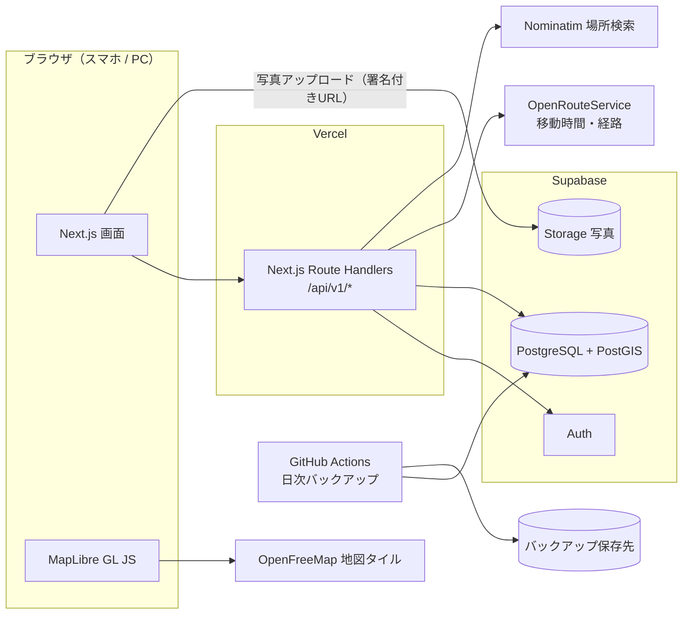
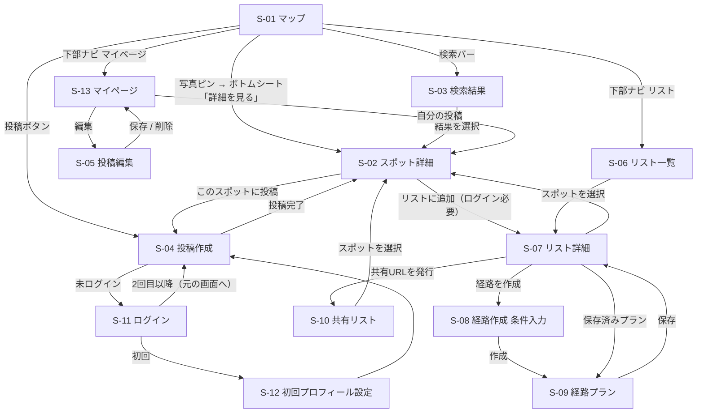
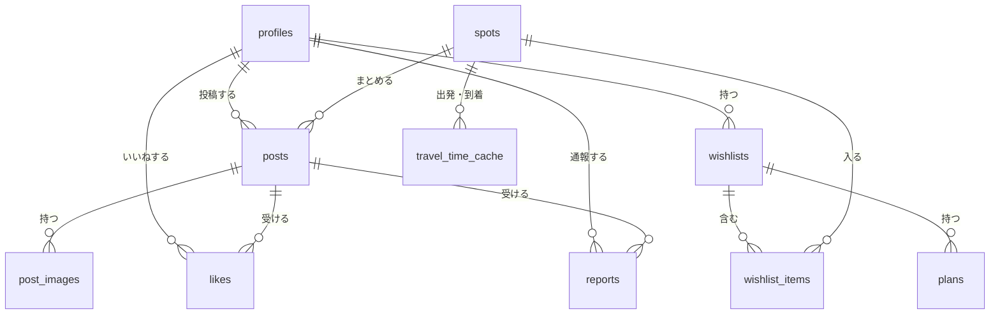

# 要件定義書：仮　旅行どこいこう

| 項目 | 内容 |
| --- | --- |
| 文書バージョン | 0.1（ドラフト） |
| 作成日 | 2026/10/10 |
| 作成者 | かずや、ぜんき、kotaro |
| 元資料 | PDR_v3.md（v0.0.3）、ADR.md（ADR-0001〜0012） |
| 状態 | 検討中（末尾「15. 検討事項」への回答をもとに更新し、検討事項がなくなったら実装に移る） |

> 本書の決定事項のうち、設計上の判断を変える必要が出たものは ADR.md に新しいADRとして追加する（既存ADRは書き換えず「書き換え済み」にする）。
> 本書中の「推奨」と書かれた技術選定・数値は、15章の回答で確定させる。

---

## 目次
1. 概要
2. 用語定義
3. システム構成
4. 機能一覧
5. 機能要件（詳細）
6. 画面一覧
7. 画面遷移図
8. UIデザイン規約
9. API設計
10. データ設計
11. 経路作成ロジック
12. 定期処理・運用処理
13. 非機能要件
14. 外部サービスと無料枠
15. 検討事項（質問と推奨案）

---

## 1. 概要

### 1.1 目的
地図上に、ユーザーが投稿した現地の写真付きピンを表示し、人気スポットや隠れた名所を視覚的に見つけられるようにする。行きたい場所を選ぶと、移動時間・滞在時間・おすすめの時間帯を考慮した無理のない回り方を自動で作成し、旅行の計画疲れを減らす。

### 1.2 対象ユーザー
旅行を計画している大学生（友達との国内旅行）。スマートフォンのブラウザでの利用を主とする。

### 1.3 スコープ
| 含める | 含めない |
| --- | --- |
| 写真付きピンの地図表示（ヒートマップ・写真の束・写真ピン） | 予約・決済 |
| 写真付きスポット投稿（スポット名検索 / GPS） | ネイティブアプリ |
| スポット詳細・検索 | 海外 |
| 行きたい場所リスト・共有 | ユーザー同士のチャット・DM |
| 滞在時間・時間帯を考慮した経路作成 | 混雑状況のリアルタイム反映 |
| ユーザー登録・ログイン | 無料枠を超える有料APIの利用 |
| 無料枠の自動管理（80%で停止） | AIチャットによる条件入力（将来検討） |

### 1.4 リリース段階と機能の対応
| 段階 | 含める機能 |
| --- | --- |
| MVP | F-1 マップ表示、F-2 スポット投稿、F-3 スポット詳細（閲覧）、F-6 認証、F-8 無料枠管理、F-9 バックアップ |
| β版 | F-3 検索・いいね、F-4 行きたい場所リスト、F-5 経路作成 |
| 正式リリース | F-4 リスト共有、F-7 通報・管理、UI・性能改善 |

> JPHACKSのデモで何を動かすかによってこの区切りは変わる（15章 Q1）。

---

## 2. 用語定義
| 用語 | 意味 |
| --- | --- |
| スポット | 地図上の1地点。複数の投稿をまとめる単位（例：清水寺） |
| 投稿 | ユーザーが1つのスポットに対して行う、写真1〜4枚とコメントのセット |
| 代表写真 | スポットの投稿写真のうち、いいね数が最も多い写真。ピンや写真の束の表に出す |
| 写真の束 | 中域ズームでスポットをまとめて表示するUI。投稿が多いほど写真が重なって厚く・大きく見える |
| 行きたい場所リスト | ユーザーが保存したスポットのまとまり（例：京都旅行） |
| 必ず行きたい | リスト内スポットの印。経路作成で外さない |
| 経路プラン | 行きたい場所リストから作成した、訪問順・到着時刻・滞在時間・移動時間のセット |
| 無料枠 | 外部サービスを無料で使える上限。80%で該当機能を停止する（ADR-0008） |
| 停止中 | 無料枠の80%に達し、機能を使えない状態 |

---

## 3. システム構成

### 3.1 推奨技術スタック（15章 Q2で確定）
| 領域 | 推奨 | 理由 |
| --- | --- | --- |
| フロントエンド / API | Next.js（App Router）＋ TypeScript | 画面とAPI（Route Handlers）を1つのリポジトリで作れる |
| スタイル | Tailwind CSS | 規約（8章）をクラス単位で守りやすい |
| アイコン | lucide-react | 指定どおり Lucide に統一 |
| 地図 | MapLibre GL JS ＋ OpenFreeMap（タイル） | 無料・APIキー不要。ヒートマップと独自ピンを実装しやすい（ADR-0009） |
| クラスタ計算 | Supercluster（ブラウザ側） | 表示範囲内のスポットを高速にまとめられる |
| 認証・DB・ストレージ | Supabase（Auth / PostgreSQL＋PostGIS / Storage）無料プラン | 認証・位置検索・画像保存を1つで賄える |
| 経路・移動時間 | OpenRouteService（無料枠） | 徒歩・車の移動時間行列と経路形状を取得できる |
| 場所検索 | 自前DB → Nominatim（OpenStreetMap） | 無料。利用規約の範囲内で使う（15章 Q6） |
| ホスティング | Vercel（Hobby） | Next.jsと相性が良く、無料 |
| エラー監視 | Sentry（無料プラン） | 例外の把握 |
| バックアップ | GitHub Actions ＋ pg_dump | 無料で毎日実行できる（ADR-0011） |

### 3.2 構成図


### 3.3 方針
- 外部APIの呼び出しはすべてサーバー（Route Handlers）経由にし、呼び出し回数を数えて無料枠を管理する（F-8）。地図タイルのみブラウザから直接取得する（OpenFreeMapは回数制限・キーなし）。
- DBへのアクセスもAPI経由に統一し、権限はSupabaseの行レベルセキュリティ（RLS）でも二重に守る。
- 写真はブラウザで縮小・変換してから、署名付きURLでStorageに直接アップロードする（サーバーの負荷と転送量を減らすため）。

---

## 4. 機能一覧
| ID | 機能 | 段階 | ログイン | 関連ADR |
| --- | --- | --- | --- | --- |
| F-1 | マップ表示・ピン表示 | MVP | 不要 | ADR-0009 |
| F-2 | スポット投稿（作成・編集・削除） | MVP | 必要 | ADR-0006, 0007 |
| F-3 | スポット詳細・検索・いいね | MVP（閲覧）/ β（検索・いいね） | 閲覧不要 / いいね必要 | — |
| F-4 | 行きたい場所リスト・共有 | β / 正式（共有） | 必要（共有閲覧は不要） | — |
| F-5 | おすすめ経路の自動作成 | β | 必要 | ADR-0010 |
| F-6 | 認証・アカウント・マイページ | MVP | — | — |
| F-7 | 通報・管理 | 正式 | 必要 | — |
| F-8 | 無料枠管理（自動停止） | MVP | — | ADR-0008 |
| F-9 | DBバックアップ | MVP | — | ADR-0011 |

---

## 5. 機能要件（詳細）

各要件には「F-番号-連番」のIDを振り、テストと受け入れ確認で使う。

### F-1 マップ表示・ピン表示

| ID | 要件 |
| --- | --- |
| F-1-1 | 初期表示は、位置情報が許可されていれば現在地周辺（ズーム13）、拒否されていれば日本全体（ズーム5）とする。 |
| F-1-2 | 地図の移動・ズームが止まってから300ms後に、表示範囲内のスポットを取得する（移動中は取得しない）。 |
| F-1-3 | ズームレベルに応じて表示を切り替える（ADR-0009）。<br>・ズーム8以下：ヒートマップ（投稿数で重み付け）<br>・ズーム9〜13：写真の束<br>・ズーム14以上：写真ピン（1スポット1ピン） |
| F-1-4 | 写真の束：代表写真を表に出し、まとまったスポットの投稿数に応じて重なり枚数（1〜3枚）とサイズ（48 / 64 / 80px）を3段階で変える。投稿数は右下の小さなバッジで補足表示する。 |
| F-1-5 | 写真ピン：代表写真のサムネイル（48px、角丸）。投稿数に応じて枠の色を3段階（通常 / 人気 / 大人気）で変え、大人気には Lucide の `flame` アイコンを添える。段階のしきい値は15章 Q11。 |
| F-1-6 | 写真の束をタップするとその範囲にズームインする。写真ピンをタップするとボトムシート（スポット名・代表写真・投稿数・「詳細を見る」）を表示する。 |
| F-1-7 | カテゴリ（自然 / グルメ / 歴史・文化 / 写真映え / その他）で絞り込みできる。 |
| F-1-8 | 現在地ボタン（`locate-fixed`）で現在地に移動する。 |

例外
- 地図タイルの読み込み失敗：「地図を読み込めませんでした」と再読み込みボタン（`refresh-cw`）を表示。
- 範囲内に投稿なし：「このエリアにはまだ投稿がありません」と投稿ボタンを表示。
- 写真の読み込み失敗：カテゴリのアイコンで代替表示。

受け入れ基準
- 1,000スポットを登録した状態で、地図移動後1秒以内にピンが再描画される。
- ズーム8/9/13/14の境界で表示方式が切り替わる。

### F-2 スポット投稿

| ID | 要件 |
| --- | --- |
| F-2-1 | ログインユーザーのみ投稿できる。未ログインで投稿ボタンを押すとログイン画面へ遷移し、ログイン後に投稿画面へ戻る。 |
| F-2-2 | 投稿は「写真選択 → 場所 → 内容入力 → 確認」の4ステップで行う。 |
| F-2-3 | 写真は1〜4枚。選択できる形式はJPEG / PNG / HEIC / WebP、元ファイル1枚あたり最大10MB。 |
| F-2-4 | 写真はブラウザで次の2サイズのWebPに変換してからアップロードする：本画像（長辺1600px）、サムネイル（長辺400px）。変換時に再エンコードすることでEXIF情報をすべて除去する。HEICは変換ライブラリでJPEG相当に変換してから処理する。 |
| F-2-5 | 場所の指定は「スポット名検索」「GPS（現在地）」のいずれか（ADR-0006）。 |
| F-2-6 | GPS：現在地を取得し、半径100m以内の既存スポットを近い順に最大10件表示する。ユーザーは選ぶだけでよい。該当がなければ「新しいスポットとして登録」を選び、スポット名を入力する（15章 Q7）。 |
| F-2-7 | スポット名検索：まず自前DBのスポットを検索し、なければ外部の場所検索（Nominatim）の結果を表示する。外部検索は入力のたびではなく「検索」ボタン押下で実行する（利用規約対応、15章 Q6）。 |
| F-2-8 | コメントは任意、最大150文字（ADR-0007）。入力中は残り文字数を表示する。 |
| F-2-9 | カテゴリは必須で、自然 / グルメ / 歴史・文化 / 写真映え / その他 から1つ選ぶ。 |
| F-2-10 | 滞在時間は任意で、〜30分 / 〜1時間 / 〜2時間 / 半日以上 から選ぶ（ADR-0010）。 |
| F-2-11 | 投稿日時はサーバーで自動記録する。 |
| F-2-12 | 自分の投稿は編集（コメント・カテゴリ・滞在時間・写真の追加削除）と削除ができる。スポットの変更はできない（削除して再投稿）。 |
| F-2-13 | 投稿・編集・削除の後、スポットの投稿数・代表写真・滞在時間の中央値・時間帯の分布を更新する。 |
| F-2-14 | スポットの投稿がすべて削除されたら、そのスポットは地図に表示しない。 |

入力チェック
| 項目 | 必須 | ルール |
| --- | --- | --- |
| 写真 | 必須 | 1〜4枚、形式・サイズは F-2-3 |
| スポット | 必須 | 既存スポットIDまたは新規スポット（名前1〜50文字・緯度経度） |
| コメント | 任意 | 0〜150文字 |
| カテゴリ | 必須 | 5種類のいずれか |
| 滞在時間 | 任意 | 4種類のいずれか |

例外
- 位置情報の拒否・取得失敗：「現在地を取得できませんでした。スポット名で検索してください」と表示し、検索に切り替える。
- GPSの誤差が100m以上：「位置の誤差が大きいため、候補から選んでください」と表示し、候補選択のみ可能にする（新規登録は不可）。
- アップロード失敗：入力内容を保持したまま再試行ボタンを表示。
- 外部検索が停止中（F-8）：「現在、外部の場所検索は利用できません」と表示し、自前DBの検索とGPSのみ使える状態にする。

受け入れ基準
- 投稿完了から5秒以内に地図へ反映される。
- 保存された画像ファイルにEXIF情報が含まれていない。
- 151文字のコメントはクライアント・サーバーの両方で拒否される。

### F-3 スポット詳細・検索・いいね

| ID | 要件 |
| --- | --- |
| F-3-1 | スポット詳細には、スポット名、住所、カテゴリ、投稿数、いいね合計、平均的な滞在時間、投稿が多い時間帯（24時間の棒グラフ）、写真ギャラリー、投稿一覧を表示する。 |
| F-3-2 | 投稿一覧は新着順、20件ずつ読み込む（無限スクロール）。 |
| F-3-3 | 投稿に「いいね」（`heart`）できる。同じ投稿へのいいねは1人1回で、もう一度押すと取り消す。（β） |
| F-3-4 | 「行きたい場所リストに追加」（`bookmark`）ボタンを置く。（β） |
| F-3-5 | 「Googleマップで開く」リンクを置く（無料のURL形式。APIキー不要）。 |
| F-3-6 | 検索：キーワード（スポット名・住所）、都道府県、市区町村、カテゴリで絞り込み、人気順（投稿数＋いいね）または新着順で並べる。結果は地図とリストの両方に表示する。（β） |

例外
- 存在しない・非表示のスポット：「このスポットは見つかりませんでした」。
- 検索結果0件：「条件を変えて検索してください」。

### F-4 行きたい場所リスト・共有

| ID | 要件 |
| --- | --- |
| F-4-1 | リストを作成・名前変更・削除できる。名前は1〜30文字、1ユーザー最大20リスト。 |
| F-4-2 | 1リストに最大30スポット。重複追加は「追加済みです」と表示して無視する。 |
| F-4-3 | スポット詳細・ボトムシートから、どのリストに追加するかを選んで追加できる。 |
| F-4-4 | リスト内スポットに「必ず行きたい」（`star`）の印を付け外しできる。 |
| F-4-5 | リスト内スポットを地図上に一括表示できる。 |
| F-4-6 | 共有用URLを発行・停止できる。共有URLはログインなしで閲覧のみ可能。（正式） |
| F-4-7 | リスト画面から経路作成（F-5）へ進める。 |

例外
- 削除されたスポット：「このスポットは削除されました」と表示し、経路作成の対象から外す。
- 停止済みの共有URL：「このリストは共有されていません」。

### F-5 おすすめ経路の自動作成

| ID | 要件 |
| --- | --- |
| F-5-1 | 条件は選択式で入力する（ADR-0010）。<br>・出発地（現在地 / スポット名検索）・到着地（任意。未指定なら出発地に戻らない）<br>・日付、開始時刻、終了時刻（初期値 9:00〜18:00）<br>・移動手段（徒歩 / 車）（公共交通は15章 Q5）<br>・旅行のペース（ゆったり ×1.3 / ふつう ×1.0 / たくさん回りたい ×0.8）<br>・重視するもの（写真映え / グルメ / 歴史・文化 / 自然、複数選択）<br>・昼食休憩（入れる場合は11:30〜13:30の間に60分） |
| F-5-2 | 対象スポットはリスト内から選ぶ（初期値は全選択）。最大10か所。 |
| F-5-3 | 訪問順・到着時刻・滞在時間を11章のロジックで計算する。 |
| F-5-4 | 結果はタイムライン（到着時刻・滞在時間・次までの移動時間）と、地図上の経路線で表示する。 |
| F-5-5 | 時間内に入らなかったスポットを「時間が足りず入らなかった場所」として表示する。 |
| F-5-6 | ユーザーは訪問順の入れ替え（ドラッグ）と滞在時間の変更ができ、変更すると時刻を再計算する（移動時間はキャッシュを使い、外部APIは再度呼ばない）。 |
| F-5-7 | 経路プランを保存・削除できる。保存したプランはリスト画面から開ける。 |
| F-5-8 | 各区間に「Googleマップで経路を開く」リンクを置く（公共交通での確認にも使える）。 |

例外
- 経路が見つからない区間：「この区間の経路が見つかりませんでした」と表示し、そのスポットを除いて再計算する。
- 「必ず行きたい」だけでも時間内に入らない：「終了時刻を延ばすか、スポットを減らしてください」。
- 停止中（F-8）：「現在、経路作成を利用できません」と表示し、作成ボタンを無効にする。

受け入れ基準
- 10か所の計算が5秒以内に終わる。
- 1回の経路作成で呼ぶ外部APIは最大2回（移動時間行列1回＋経路形状1回）。
- 終了時刻を超えるプラン、営業時間外に到着するプランが出ない。

### F-6 認証・アカウント・マイページ

| ID | 要件 |
| --- | --- |
| F-6-1 | Googleアカウントでログインできる（メールでのログインは15章 Q8）。 |
| F-6-2 | 初回ログイン時に表示名（1〜20文字、初期値はGoogleの名前）を確認してもらう。 |
| F-6-3 | マイページで自分の投稿一覧、表示名・アイコンの変更、ログアウト（`log-out`）ができる。 |
| F-6-4 | 退会できる。退会時は投稿・リスト・経路プラン・写真を削除する。 |
| F-6-5 | 地図・スポット詳細・検索・共有リストはログインなしで閲覧できる。 |

### F-7 通報・管理（正式リリース）

| ID | 要件 |
| --- | --- |
| F-7-1 | 投稿を通報（`flag`）できる。理由：不適切な画像 / 場所が違う / スパム / その他（任意で100文字まで）。 |
| F-7-2 | 同じ投稿に3件以上の通報が集まったら自動で非表示にする（しきい値は15章 Q13）。 |
| F-7-3 | 管理者は通報の確認、投稿の非表示・再表示ができる（管理画面を作るかは15章 Q13）。 |

### F-8 無料枠管理（自動停止）

| ID | 要件 |
| --- | --- |
| F-8-1 | 外部APIを呼ぶたびに、サービス・種類・年月ごとの呼び出し回数を記録する。日単位の上限があるサービスは日ごとにも記録する。 |
| F-8-2 | 呼び出し前に回数を確認し、無料枠の80%に達していたら呼び出さず、停止中として503（`FEATURE_SUSPENDED`）を返す。 |
| F-8-3 | 停止・再開時にログを残し、メンバーに通知する（通知先は15章 Q14）。 |
| F-8-4 | 期間（日・月）が切り替わると自動で再開する（回数を期間ごとに記録しているため、特別な処理は不要）。 |
| F-8-5 | 画面は起動時に `GET /api/v1/system/status` で停止中の機能を取得し、該当ボタンを無効化して理由を表示する。 |
| F-8-6 | 外部サービス側の管理画面でも、設定できる場合は1日の上限（クォータ）を設定する。 |

### F-9 DBバックアップ
ADR-0011のとおり。詳細は12章。

---

## 6. 画面一覧

| ID | 画面 | URL | ログイン | 主な要素 | 機能 |
| --- | --- | --- | --- | --- | --- |
| S-01 | マップ（トップ） | `/` | 不要 | 地図、検索バー、カテゴリ絞り込み、現在地ボタン、ボトムシート | F-1 |
| S-02 | スポット詳細 | `/spots/[spotId]` | 不要 | 写真ギャラリー、情報、時間帯グラフ、投稿一覧、いいね、リスト追加 | F-3 |
| S-03 | 検索結果 | `/search` | 不要 | 条件、地図、結果リスト | F-3 |
| S-04 | 投稿作成 | `/posts/new` | 必要 | 4ステップ（写真 / 場所 / 内容 / 確認） | F-2 |
| S-05 | 投稿編集 | `/posts/[postId]/edit` | 必要（本人） | 写真・内容の編集、削除 | F-2 |
| S-06 | リスト一覧 | `/lists` | 必要 | リスト一覧、新規作成 | F-4 |
| S-07 | リスト詳細 | `/lists/[listId]` | 必要（本人） | スポット一覧、必ず行きたい、地図表示、共有、保存済みプラン、経路作成ボタン | F-4 |
| S-08 | 経路作成（条件入力） | `/lists/[listId]/plan` | 必要（本人） | 条件フォーム、対象スポット選択 | F-5 |
| S-09 | 経路プラン | `/plans/[planId]`（未保存時は `/lists/[listId]/plan/result`） | 必要（本人） | タイムライン、地図、入らなかった場所、保存 | F-5 |
| S-10 | 共有リスト | `/shared/[token]` | 不要 | スポット一覧、地図（閲覧のみ） | F-4 |
| S-11 | ログイン | `/login` | — | Googleでログイン、規約への同意文 | F-6 |
| S-12 | 初回プロフィール設定 | `/welcome` | 必要 | 表示名 | F-6 |
| S-13 | マイページ | `/me` | 必要 | 自分の投稿一覧、プロフィール編集、ログアウト、退会 | F-6 |
| S-14 | 利用規約 / プライバシーポリシー | `/terms`, `/privacy` | 不要 | 文章 | — |
| S-15 | エラー / 見つかりません | — | — | メッセージ、トップへ戻る | — |

共通レイアウト
- スマホ：下部ナビゲーション（マップ `map` / リスト `bookmark` / 投稿 `camera` / マイページ `user`）。投稿は中央に大きめのボタン。
- PC（幅1024px以上）：左にサイドパネル（詳細・リスト）、右に地図の2カラム。下部ナビは上部ヘッダーに置き換える。

---

## 7. 画面遷移図



---

## 8. UIデザイン規約

### 8.1 アイコン
- アイコンはすべて Lucide（`lucide-react`）を使う。**絵文字は使わない**（画面の文言、ボタン、トースト、プレースホルダー、初期データ、通知、エラーメッセージを含む）。
- サイズは本文横で16px、ボタンで20px、下部ナビで24px。線の太さ（strokeWidth）は2に統一。色は `currentColor`（文字色に合わせる）。
- アイコンだけのボタンには `aria-label` を必ず付ける。タップ領域は44×44px以上。
- アイコンの意味は下表に統一し、同じ意味に別のアイコンを使わない。

| 用途 | Lucide アイコン名 |
| --- | --- |
| マップ（下部ナビ） | `map` |
| リスト / リストに追加 | `bookmark` / `bookmark-plus` |
| 投稿 | `camera` |
| マイページ | `user` |
| 検索 | `search` |
| 絞り込み | `sliders-horizontal` |
| 現在地 | `locate-fixed` |
| スポット・場所 | `map-pin` |
| 写真を追加 | `image-plus` |
| いいね | `heart` |
| 必ず行きたい | `star` |
| 大人気 | `flame` |
| 経路作成 | `route` |
| 徒歩 / 車 / 公共交通 | `footprints` / `car` / `train-front` |
| 時刻・滞在時間 | `clock` |
| 昼食休憩 | `utensils` |
| 共有 | `share-2` |
| 通報 | `flag` |
| 編集 / 削除 | `pencil` / `trash-2` |
| 閉じる / 戻る | `x` / `chevron-left` |
| 外部で開く（Googleマップ） | `external-link` |
| 再読み込み | `refresh-cw` |
| 読み込み中 | `loader-circle`（回転） |
| エラー / 注意 | `circle-alert` / `triangle-alert` |
| 停止中 | `circle-pause` |
| ログイン / ログアウト | `log-in` / `log-out` |
| カテゴリ：自然 / グルメ / 歴史・文化 / 写真映え / その他 | `trees` / `utensils` / `landmark` / `aperture` / `map-pin` |

> カテゴリ「グルメ」と「昼食休憩」が同じ `utensils` になるため、昼食休憩は `coffee` にするか15章 Q12で確認する。

### 8.2 カード・強調表現
- **border-left（片側だけに色付きの線を付ける）アクセントカードは使わない。** `border-l-4` などのクラスや、左端の色帯で種類・状態を表す表現を禁止する。
- カードは「四辺同じ太さ（1px）の淡い枠線」または「淡い背景色」で区切り、角丸12px、影はごく薄く（または無し）とする。
- 状態や種類（例：停止中、大人気、必ず行きたい、エラー）は、**アイコン＋文字ラベルのバッジ**、またはカード全体の淡い背景色で表す。色だけに頼らず必ず文字を添える。
- 注意・エラーメッセージも同様に、枠線全周または背景色＋`circle-alert` アイコン＋文言で表す。

### 8.3 その他
- 主要な色はデザイントークン（CSS変数）で管理する。ダークモードは15章 Q12。
- 文字サイズは本文16px以上（スマホで拡大されないように入力欄も16px）。
- 写真が主役のため、UIの装飾は控えめにする。
- 文言は日本語のみ（15章 Q12）。

---

## 9. API設計

### 9.1 共通仕様
| 項目 | 仕様 |
| --- | --- |
| ベースパス | `/api/v1` |
| 形式 | JSON（UTF-8）。日時はISO 8601（`+09:00`付き）、座標は `lat` / `lng`（WGS84） |
| 認証 | Supabase Authのセッション（Cookie）。ログインが必要なAPIで未ログインなら401 |
| ページング | カーソル方式：`?cursor=...&limit=20`、レスポンスに `nextCursor`（なければ `null`） |
| 入力チェック | サーバーで必ず行う（クライアントと同じルールのスキーマを共有） |
| 利用制限 | ログインユーザーの投稿は1分に5件まで、外部検索は1秒に1回まで（超過時429） |

エラー形式
```json
{
  "error": {
    "code": "VALIDATION_ERROR",
    "message": "コメントは150文字以内で入力してください",
    "details": [{ "field": "comment", "reason": "max_length" }]
  }
}
```

| HTTP | code | 意味 |
| --- | --- | --- |
| 400 | `VALIDATION_ERROR` | 入力値が不正 |
| 401 | `UNAUTHORIZED` | 未ログイン |
| 403 | `FORBIDDEN` | 権限なし（他人の投稿の編集など） |
| 404 | `NOT_FOUND` | 対象が存在しない |
| 409 | `CONFLICT` | 重複（リストへの重複追加など） |
| 413 | `PAYLOAD_TOO_LARGE` | 画像サイズ超過 |
| 429 | `RATE_LIMITED` | 呼び出しすぎ |
| 502 | `UPSTREAM_ERROR` | 外部APIのエラー |
| 503 | `FEATURE_SUSPENDED` | 無料枠の80%に達して停止中（`details.feature` に機能名） |

### 9.2 エンドポイント一覧
| メソッド | パス | 概要 | ログイン | 機能 |
| --- | --- | --- | --- | --- |
| GET | `/system/status` | 停止中の機能一覧 | 不要 | F-8 |
| GET | `/spots` | 表示範囲内のスポット取得（地図用） | 不要 | F-1 |
| GET | `/spots/nearby` | 現在地近くのスポット候補 | 必要 | F-2 |
| GET | `/spots/search` | スポット検索 | 不要 | F-3 |
| GET | `/spots/{spotId}` | スポット詳細 | 不要 | F-3 |
| GET | `/spots/{spotId}/posts` | スポットの投稿一覧 | 不要 | F-3 |
| GET | `/places/search` | 外部の場所検索（Nominatim） | 必要 | F-2, F-5 |
| POST | `/uploads` | 写真アップロード用の署名付きURL発行 | 必要 | F-2 |
| POST | `/posts` | 投稿作成（新規スポット作成を含む） | 必要 | F-2 |
| PATCH | `/posts/{postId}` | 投稿編集 | 必要（本人） | F-2 |
| DELETE | `/posts/{postId}` | 投稿削除 | 必要（本人） | F-2 |
| PUT | `/posts/{postId}/like` | いいね | 必要 | F-3 |
| DELETE | `/posts/{postId}/like` | いいね取り消し | 必要 | F-3 |
| POST | `/posts/{postId}/reports` | 通報 | 必要 | F-7 |
| GET | `/me` | 自分のプロフィール | 必要 | F-6 |
| PATCH | `/me` | プロフィール更新 | 必要 | F-6 |
| DELETE | `/me` | 退会 | 必要 | F-6 |
| GET | `/me/posts` | 自分の投稿一覧 | 必要 | F-6 |
| GET | `/lists` | リスト一覧 | 必要 | F-4 |
| POST | `/lists` | リスト作成 | 必要 | F-4 |
| GET | `/lists/{listId}` | リスト詳細（スポット・保存済みプラン含む） | 必要（本人） | F-4 |
| PATCH | `/lists/{listId}` | リスト名変更 | 必要（本人） | F-4 |
| DELETE | `/lists/{listId}` | リスト削除 | 必要（本人） | F-4 |
| POST | `/lists/{listId}/items` | スポット追加 | 必要（本人） | F-4 |
| PATCH | `/lists/{listId}/items/{spotId}` | 必ず行きたいの切り替え | 必要（本人） | F-4 |
| DELETE | `/lists/{listId}/items/{spotId}` | スポット削除 | 必要（本人） | F-4 |
| POST | `/lists/{listId}/share` | 共有URL発行 | 必要（本人） | F-4 |
| DELETE | `/lists/{listId}/share` | 共有停止 | 必要（本人） | F-4 |
| GET | `/shared/{token}` | 共有リスト閲覧 | 不要 | F-4 |
| POST | `/plans/compute` | 経路プランの計算（保存しない） | 必要 | F-5 |
| POST | `/plans/recompute` | 順番・滞在時間変更後の再計算（外部API呼び出しなし） | 必要 | F-5 |
| POST | `/plans` | 経路プランの保存 | 必要 | F-5 |
| GET | `/plans/{planId}` | 保存済みプラン | 必要（本人） | F-5 |
| DELETE | `/plans/{planId}` | プラン削除 | 必要（本人） | F-5 |
| GET | `/admin/reports` | 通報一覧 | 管理者 | F-7 |
| PATCH | `/admin/posts/{postId}` | 投稿の非表示・再表示 | 管理者 | F-7 |

### 9.3 主要APIの詳細

#### GET /spots（地図用）
クエリ
| 名前 | 必須 | 説明 |
| --- | --- | --- |
| `bbox` | 必須 | `minLng,minLat,maxLng,maxLat` |
| `zoom` | 必須 | 0〜22 |
| `category` | 任意 | カンマ区切り |

レスポンス（`zoom<=8` はヒートマップ用の点、それ以外はスポット。写真の束へのまとめはブラウザ側のSuperclusterで行う）
```json
{
  "mode": "spots",
  "spots": [
    {
      "id": "b1c2...",
      "name": "伏見稲荷大社",
      "lat": 34.9671,
      "lng": 135.7727,
      "category": "history",
      "postCount": 128,
      "popularity": "very_popular",
      "coverThumbUrl": "https://.../thumb.webp"
    }
  ]
}
```
```json
{
  "mode": "heatmap",
  "points": [{ "lat": 34.9671, "lng": 135.7727, "weight": 128 }]
}
```
- 1回の返却は最大2,000件。超える場合は投稿数の多い順に切り詰める。

#### GET /spots/nearby
クエリ：`lat`, `lng`, `accuracy`（メートル）, `radius`（初期値100、最大300）
```json
{
  "canCreate": true,
  "spots": [{ "id": "...", "name": "...", "distanceM": 24, "coverThumbUrl": "..." }]
}
```
- `accuracy` が100以上なら `canCreate: false`（新規スポット登録不可）。

#### POST /uploads
リクエスト
```json
{ "files": [{ "kind": "full", "contentType": "image/webp", "size": 412000 }, { "kind": "thumb", "contentType": "image/webp", "size": 38000 }] }
```
レスポンス
```json
{ "uploads": [{ "kind": "full", "path": "posts/tmp/u123/abc.webp", "signedUrl": "https://..." }] }
```
- 変換後のファイルは1枚あたり最大2MB。

#### POST /posts
リクエスト（既存スポット）
```json
{
  "spotId": "b1c2...",
  "images": [{ "fullPath": "posts/tmp/u123/abc.webp", "thumbPath": "posts/tmp/u123/abc_t.webp", "width": 1600, "height": 1200 }],
  "comment": "朝7時前なら人が少なくて千本鳥居がきれいに撮れます",
  "category": "history",
  "stayDuration": "lt60"
}
```
リクエスト（新規スポット：`spotId` の代わりに `newSpot`）
```json
{
  "newSpot": { "name": "鴨川デルタの飛び石", "lat": 35.0302, "lng": 135.7726, "source": "gps", "accuracyM": 12 }
}
```
- 新規スポットは、半径50m以内に同名（表記ゆれ含む）のスポットがあれば409を返し、既存スポットを候補として返す。
- `stayDuration`：`lt30` / `lt60` / `lt120` / `half_day` / `null`
- `category`：`nature` / `gourmet` / `history` / `photogenic` / `other`

レスポンス：`201` ＋ 作成した投稿とスポットID。

#### POST /plans/compute
リクエスト
```json
{
  "listId": "l123",
  "spotIds": ["s1", "s2", "s3"],
  "origin": { "lat": 34.9858, "lng": 135.7588, "label": "京都駅" },
  "destination": null,
  "date": "2026-11-03",
  "startTime": "09:00",
  "endTime": "18:00",
  "mode": "walking",
  "pace": "normal",
  "interests": ["photogenic", "history"],
  "lunchBreak": true
}
```
レスポンス
```json
{
  "items": [
    { "type": "spot", "spotId": "s2", "arrive": "09:25", "stayMin": 60, "depart": "10:25", "travelMinToNext": 18, "inBestTime": true },
    { "type": "lunch", "arrive": "12:00", "stayMin": 60, "depart": "13:00" }
  ],
  "skipped": [{ "spotId": "s3", "reason": "time_limit" }],
  "totalTravelMin": 74,
  "endAt": "17:10",
  "geometry": { "type": "LineString", "coordinates": [[135.7588, 34.9858]] },
  "travelMatrixId": "tm_abc"
}
```
- `travelMatrixId` は再計算（`/plans/recompute`）時に移動時間を使い回すためのID。

---

## 10. データ設計

### 10.1 ER図


### 10.2 テーブル定義（PostgreSQL）

profiles（auth.users と1対1）
| 列 | 型 | 制約・説明 |
| --- | --- | --- |
| id | uuid | PK、auth.users.id |
| display_name | text | 1〜20文字 |
| avatar_url | text | NULL可 |
| is_admin | boolean | 初期値 false |
| created_at | timestamptz | |

spots
| 列 | 型 | 制約・説明 |
| --- | --- | --- |
| id | uuid | PK |
| name | text | 1〜50文字 |
| location | geography(Point, 4326) | GISTインデックス |
| address / prefecture / city | text | 逆ジオコーディングまたは検索結果から設定 |
| category | text | 投稿で最も多いカテゴリ |
| source | text | `gps` / `search_db` / `search_external` |
| external_ref | text | 外部検索のID（OSMのIDなど）。NULL可 |
| post_count | int | 公開中の投稿数 |
| like_count | int | 投稿のいいね合計 |
| cover_image_id | uuid | 代表写真。NULL可 |
| stay_minutes_median | int | 滞在時間の中央値（投稿3件以上で設定） |
| hour_histogram | int[24] | 投稿時刻（日本時間）の分布 |
| opening_hours | jsonb | 営業時間（取得できる場合のみ、15章 Q10） |
| created_by | uuid | profiles.id |
| created_at | timestamptz | |

posts
| 列 | 型 | 制約・説明 |
| --- | --- | --- |
| id | uuid | PK |
| user_id | uuid | FK profiles、退会時に削除 |
| spot_id | uuid | FK spots |
| comment | text | `char_length(comment) <= 150` |
| category | text | 5種類のCHECK制約 |
| stay_duration | text | 4種類または NULL |
| like_count | int | |
| status | text | `public` / `hidden` |
| created_at / updated_at | timestamptz | |

post_images
| 列 | 型 | 制約・説明 |
| --- | --- | --- |
| id | uuid | PK |
| post_id | uuid | FK posts（削除時に連動削除） |
| full_path / thumb_path | text | Storageのパス |
| width / height | int | |
| sort_order | smallint | 0〜3 |

likes：`(user_id, post_id)` を主キー、created_at
wishlists：id、user_id、name（1〜30文字）、share_token（ランダム32文字、UNIQUE、NULL可）、created_at
wishlist_items：`(wishlist_id, spot_id)` を主キー、must_visit（boolean）、created_at
plans：id、wishlist_id、user_id、params（jsonb：条件）、result（jsonb：計算結果）、total_travel_min、created_at
travel_time_cache：`(from_key, to_key, mode)` を主キー、duration_sec、distance_m、fetched_at（`from_key` はスポットIDまたは丸めた座標。30日で期限切れ）
api_usage：`(provider, feature, period)` を主キー、count、limit、suspended_at（`period` は `2026-10` または `2026-10-10`）
reports：id、post_id、reporter_id、reason、note（100文字まで）、status（`open` / `resolved`）、created_at。`(post_id, reporter_id)` はUNIQUE

### 10.3 権限（RLS）の方針
| テーブル | 読み取り | 書き込み |
| --- | --- | --- |
| spots, posts（public）, post_images, likes の件数 | 全員 | 投稿者本人（APIで作成） |
| posts（hidden） | 本人・管理者 | 管理者 |
| wishlists, wishlist_items, plans | 本人（共有中のリストは share_token 経由でAPIのみ） | 本人 |
| profiles | 表示名・アイコンは全員 | 本人 |
| reports, api_usage | 管理者・サーバー | サーバー |

### 10.4 Storage
- バケット `post-images`（公開読み取り、書き込みは署名付きURLのみ）。
- パス：`posts/{postId}/{imageId}.webp`、`posts/{postId}/{imageId}_t.webp`。アップロード直後は `posts/tmp/{userId}/...` に置き、投稿作成時に移動する。投稿されなかった一時ファイルは毎日削除する（12章）。

---

## 11. 経路作成ロジック（ADR-0010）

1. 対象スポットの滞在時間を決める。
   - 投稿3件以上：滞在時間の中央値（`lt30`=30分、`lt60`=60分、`lt120`=120分、`half_day`=240分として計算）
   - それ以外：カテゴリの標準値（自然60分 / グルメ60分 / 歴史・文化45分 / 写真映え30分 / その他45分。15章 Q9）
   - 「重視するもの」に当てはまるカテゴリは ×1.2、さらにペースの倍率（×1.3 / ×1.0 / ×0.8）を掛け、5分単位に丸める。
2. おすすめ時間帯を決める：`hour_histogram` の上位の時間帯（投稿5件以上のスポットのみ）。5件未満は時間帯の指定なし。
3. 出発地・スポット・到着地の移動時間行列を取得する（キャッシュにない場合のみ外部APIを1回呼ぶ）。
4. 訪問順の候補を作る。
   - 8か所以下：全通り（最大40,320通り）
   - 9〜10か所：近い順に並べた初期解から、2か所を入れ替えて改善する方法（2-opt）を繰り返す
5. 各候補について、開始時刻から順に到着時刻を計算する。昼食休憩ありの場合、11:30〜13:30の間で最初に空いた時点に60分入れる。終了時刻を超える、または営業時間外に到着する候補は除外する。
6. 点数（小さいほど良い）＝ 合計移動時間（分）＋ おすすめ時間帯から外れた時間（分）×0.5。最も点数の小さい順を採用する。
7. 候補が残らない場合は、「必ず行きたい」以外のスポットから、外したときに点数が最も良くなるものを1つずつ外して4へ戻る。
8. 決まった順で経路形状を取得し（外部API 1回）、結果を返す。

---

## 12. 定期処理・運用処理
| 処理 | 頻度 | 実行場所 | 内容 |
| --- | --- | --- | --- |
| DBバックアップ | 毎日 3:00 | GitHub Actions | pg_dump → 圧縮 → 暗号化 → 保存（30日保持）。失敗時はメール通知（ADR-0011） |
| 写真バックアップ | 毎週 月曜 4:00 | GitHub Actions | Storageの写真を別の保存先へ同期 |
| 一時ファイル削除 | 毎日 4:30 | GitHub Actions または Supabase Cron | 24時間以上経った `posts/tmp/` を削除 |
| 移動時間キャッシュ削除 | 毎日 | 同上 | 30日を過ぎたキャッシュを削除 |
| 無料プランの休止防止 | 毎日 | GitHub Actions | DBへ軽い問い合わせを行い、アクセスなしによる一時停止を防ぐ |
| 復元テスト | 毎月 | 手動 | ダンプをローカルに復元して確認 |

---

## 13. 非機能要件
| 区分 | 要件 |
| --- | --- |
| 性能 | 地図の初期表示3秒以内（4G回線想定）、ピン再描画1秒以内、経路計算（10か所）5秒以内、投稿の地図反映5秒以内 |
| 対応環境 | iOS Safari・Android Chrome・PC版 Chrome / Edge / Safari の最新2バージョン。画面幅360px〜 |
| 同時接続 | 100ユーザー程度 |
| セキュリティ | HTTPSのみ。RLSで権限を二重に保護。外部APIキーはサーバーのみで保持。写真のEXIFは全削除。ユーザーの現在地は保存しない（スポットの座標としてのみ保存） |
| 個人情報 | 保持するのはGoogleアカウントのメールアドレス、表示名、アイコンのみ。ログにメールアドレス・現在地を残さない |
| 可用性 | SLAなし。障害時は直前のデプロイへ戻す。DBは毎日バックアップ |
| アクセシビリティ | タップ領域44px以上、アイコンのみのボタンに `aria-label`、色だけで情報を伝えない、文字と背景のコントラスト比4.5以上 |
| 監視 | Sentryでエラー検知、エラー率5%超で通知、無料枠80%で自動停止（F-8） |
| ログ | アクセス・操作（投稿・いいね・リスト・経路作成）・エラー・外部API利用・バックアップ結果 |

---

## 14. 外部サービスと無料枠
数値は2026/10時点の想定。実装前に各公式サイトで確認し、本表を更新する。

| サービス | 用途 | 無料枠（目安） | 本アプリの停止条件 |
| --- | --- | --- | --- |
| OpenFreeMap | 地図タイル | 制限なし・キー不要（寄付で運営） | なし（障害時は再読み込み表示） |
| OpenRouteService | 移動時間行列・経路形状 | 経路 2,000回/日、行列 500回/日（要確認） | 各80%（1,600回 / 400回）で経路作成を停止 |
| Nominatim（公開サーバー） | 場所検索・逆ジオコーディング | 1秒に1回まで、自動補完は禁止 | サーバー側で1秒1回に制限。日500回で停止（自主上限） |
| Supabase Free | 認証・DB・Storage | DB 500MB、Storage 1GB、転送量 5GB/月（要確認） | 使用量80%でメンバーに通知（停止するとサービス全体が止まるため、通知のみ。15章 Q4） |
| Vercel Hobby | ホスティング | 非商用のみ | — |
| Sentry Developer | エラー監視 | 月5,000件程度（要確認） | — |
| GitHub Actions | バックアップ等 | 非公開リポジトリ 月2,000分 | — |
| Cloudflare R2 | バックアップ保存 | 10GB | — |

---

## 15. 検討事項（質問と推奨案）

回答しやすいよう、各質問に推奨案を付けています。「推奨でOK」または番号と選択肢で回答してください。回答をもとに本書とADRを更新し、新しい質問が出なくなったら実装に移ります。

### 優先度：高（実装の前提になるもの）

**Q1. JPHACKSのスケジュールと、デモで動かしたい機能は？**
- 背景：本書ではMVPに経路作成（F-5）を含めていないが、経路作成はこのアプリの一番の売りであり、デモで見せないと伝わりにくい。
- 選択肢：A. デモまでにMVP（地図・投稿・詳細）だけ / B. MVP＋行きたい場所リスト＋経路作成 / C. 全機能
- **推奨：B。** 「写真で探す → リストに入れる → 経路ができる」という一連の流れを見せられる。代わりに検索・いいね・共有・通報は後回しにする。
- あわせて教えてほしいこと：開発期間（デモ日・提出締切）、メンバーの担当分け（フロント / API / 地図など）。

**Q2. 技術スタックは3.1の推奨（Next.js＋TypeScript＋Tailwind＋Supabase＋MapLibre＋OpenRouteService、Vercelで公開）でよいか？**
- **推奨：このまま採用。** 確定したらADR-0013として記録する。
- 注意：使用するNext.jsは最新版で、App Routerの書き方が以前と変わっている部分があるため、実装時は同梱のドキュメントを確認しながら進める。

**Q3. 提案中のADR-0009（ピン表示）、ADR-0010（経路作成）、ADR-0011（バックアップ）を承認してよいか？**
- **推奨：3つとも承認。** 承認後、状態を「承認済み」に変える。

**Q4. Supabaseの無料枠（DB・Storage・転送量）が80%に達したときも「停止」にするか？**
- 背景：外部APIは機能単位で止められるが、Supabaseはアプリ全体の土台なので、止めるとアプリ全体が使えなくなる。
- 選択肢：A. メンバーへの通知のみ / B. 新規投稿（写真アップロード）だけ停止し、閲覧は続ける / C. 全体停止
- **推奨：B。** 容量を増やす原因の大半は写真なので、投稿だけ止めれば閲覧は守れる。ADR-0008の補足としてADRを追加する。

**Q5. 経路作成の移動手段に「公共交通」を含めるか？**
- 背景：無料で使える経路APIは、日本の電車・バスの経路にほぼ対応していない。Googleの経路APIは公共交通に対応するが、無料枠を超えると課金になる。
- 選択肢：A. 徒歩・車のみ＋各区間に「Googleマップで開く（公共交通）」リンク / B. Google Routes APIを無料枠内で使い公共交通にも対応
- **推奨：A。** 無料方針に合い、リンクでGoogleマップの乗換案内を見られるため実用上も困らない。ただし公共交通での旅行が多い大学生にとっては、徒歩だけの移動時間では遠いスポット間の時間が過大になる点に注意。

**Q6. スポット名検索の外部サービスは？**
- 背景：Nominatimの公開サーバーは無料だが「1秒1回まで」「入力中の自動補完は禁止」というルールがある。
- 選択肢：A. 自前DB優先＋Nominatim（検索ボタン押下時のみ） / B. Google Places API（無料枠内、自動補完あり） / C. 自前DBのみ
- **推奨：A。** 投稿が増えるほど自前DBで見つかるようになる。B は便利だが無料枠の管理が増える。

**Q7. GPSで近くに既存スポットがないとき、新しいスポットを作れるようにするか？**
- 背景：作れないと「隠れた名所」が投稿できない。作れると、同じ場所に別名のスポットが乱立する・自宅など私的な場所が登録される可能性がある。
- 選択肢：A. 作れる（GPS誤差100m未満のときのみ、名前は必須） / B. 作れない（外部検索で見つかる場所のみ）
- **推奨：A。** 半径50m以内の似た名前は既存スポットを提案して重複を防ぐ。私的な場所の問題はリスク対応としてMVP以降に検討する（ADR-0012）。

**Q8. ログイン方法は？**
- 背景：Supabase無料プランの標準メール送信は1時間あたりの送信数が非常に少なく、メール認証を使うと登録が詰まりやすい。
- 選択肢：A. Googleログインのみ / B. Google＋メール（外部のメール送信サービスを設定）
- **推奨：A。** 対象の大学生はほぼGoogleアカウントを持っている。

### 優先度：中（実装中に決めても間に合うもの）

**Q9. カテゴリと滞在時間の標準値はこれでよいか？**
- 現案：自然60分 / グルメ60分 / 歴史・文化45分 / 写真映え30分 / その他45分
- 追加候補：「買い物」「体験・アクティビティ」「温泉」
- **推奨：5種類のまま開始し、初期データ投入時に足りないと感じたら追加する。**

**Q10. 営業時間はどこから取得するか？**
- 選択肢：A. MVPでは扱わない（営業時間の判定をしない） / B. OpenStreetMapの営業時間情報（無料、登録されている場所のみ） / C. Google Places（有料寄り）
- **推奨：A→B。** MVP（デモ）では扱わず、後からOSMの情報を取り込む。経路が営業時間外になる可能性はデモの注意点として把握しておく。

**Q11. 人気度3段階のしきい値は？**
- 現案：通常（1〜4件）/ 人気（5〜19件）/ 大人気（20件以上）
- **推奨：現案で開始し、初期データの件数を見て調整。** 投稿が少ない初期は大人気がほぼ出ないため、エリア内の相対順位（上位10%を大人気）にする案もある。

**Q12. デザインの細部**
- ダークモード：**推奨は対応しない（ライトのみ）。** 写真が主役で、地図タイルもライト版の方が見やすい。
- 言語：**推奨は日本語のみ。**
- 昼食休憩のアイコン：グルメ（`utensils`）と重なるため **推奨は `coffee`。**
- メインカラー：未定。候補を出すので、イメージ（例：空色・夕焼け・緑）があれば教えてほしい。

**Q13. 通報・管理の進め方**
- 自動非表示のしきい値：**推奨は3件。**
- 管理画面：**推奨は作らず、Supabaseの管理画面で直接操作する**（正式リリースまで）。

**Q14. 停止・バックアップ失敗などの通知先は？**
- 選択肢：A. メール / B. Discord（Webhook） / C. Slack
- **推奨：チームで普段使っているチャット（Discordなら B）。**

### 優先度：低（確認のみ）

**Q15. リポジトリ**
- GitHubのリポジトリ名、公開 / 非公開は？
- **推奨：非公開。** バックアップのファイルを置く可能性があり、APIキーの誤公開も防げる。公開が必要になったらバックアップ処理を別リポジトリに分ける。

**Q16. 初期データ**
- 公開前にメンバーで投稿しておくエリアと件数は？
- **推奨：1エリア（例：京都市内、または大学周辺）に30〜50スポット、各1〜3投稿。** 滞在時間も入力し、経路作成のデモに使える状態にする。写真は自分たちで撮影したものに限る。

**Q17. スポット詳細の表示方法（スマホ）**
- 選択肢：A. 別ページに遷移 / B. 地図の上にボトムシートで全画面表示（地図に戻りやすい）
- **推奨：B（URLは `/spots/[spotId]` のまま、直接開いた場合はページとして表示）。**
