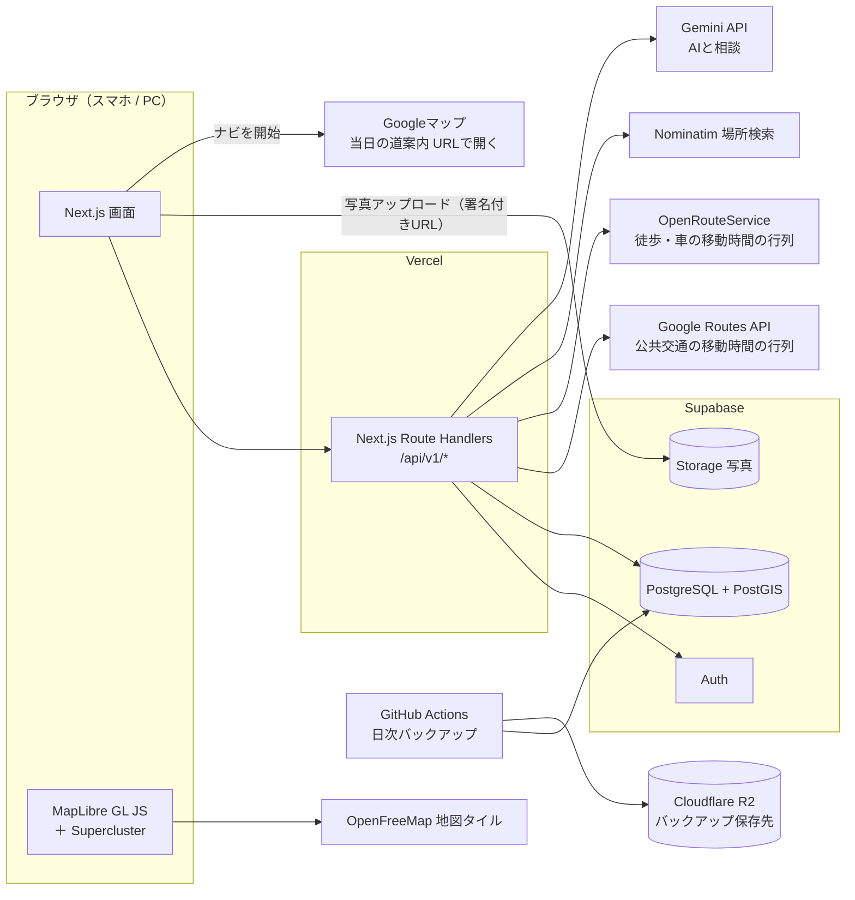
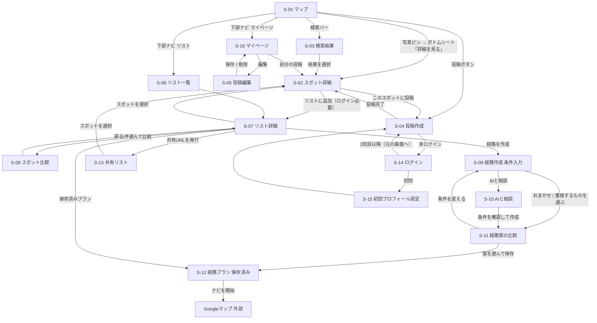
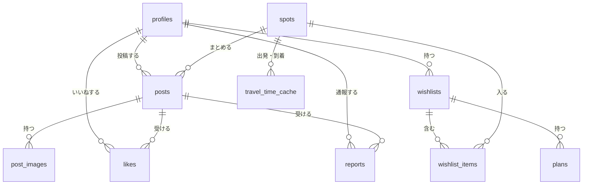
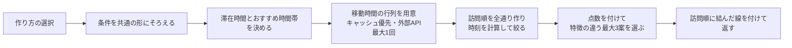

# 要件定義書

# 要件定義書：仮　旅行どこいこう

| 項目 | 内容 |
| --- | --- |
| 文書バージョン | 0.3（ドラフト） |
| 作成日 | 2026/10/10 |
| 更新日 | 2026/10/21 |
| 作成者 | かずや、ぜんき、kotaro |
| 元資料 | PDR_v3.md（v0.0.3）、ADR.md（ADR-0001〜0017） |
| 状態 | 検討中（末尾「15. 検討事項」への回答をもとに更新し、検討事項がなくなったら実装に移る） |

> 本書の決定事項のうち、設計上の判断を変える必要が出たものは ADR.md に新しいADRとして追加する（既存ADRは書き換えず「書き換え済み」にする）。
> 
> 
> Notion に貼り付けても表が崩れないよう、表の前後には必ず空行を入れ、表のセルの中では改行（`<br>`）を使わない。
> 

### 変更履歴

| 版 | 日付 | 主な変更 |
| --- | --- | --- |
| 0.1 | 2026/10/10 | 初版 |
| 0.2 | 2026/10/12 | 15章（v0.1）への回答とレビュー指摘を反映 |
| 0.3 | 2026/10/21 | 15章（v0.2）への回答とレビュー指摘を反映。下表のとおり |

v0.3 の主な変更点

| 区分 | 変更内容 | 根拠 |
| --- | --- | --- |
| 初期データ | テストデータ・初期データを石川県金沢市に変更。例文・APIの例も金沢に変更 | レビュー1 |
| 実装の進め方 | 基本の画面と機能を先に作り、経路のアルゴリズムは後から調整する順番を追加（1.9） | レビュー2 |
| F-4-8 | 拠点機能の目的と想定ユースケースを追記（F-4 冒頭）。範囲は15章 Q1 で確認 | レビュー3 |
| F-5 範囲 | 経路作成は「リスト内のスポットの1日分の回り方」に決定。対象は最大8か所（9か所以上は選択不可）。訪問順は全通りを計算 | v0.2 Q1、ADR-0017 |
| F-5 点数 | 「優先すること」の選択肢を先に決め、選択肢ごとに重みの初期値を設定（11.3） | v0.2 Q1 |
| F-5 経路情報 | 外部APIから取得するのは計画に必要な移動時間（行列）だけにする。路線・乗換・経路の形は取得せず、当日の道案内は保存したプランの「ナビを開始」から Googleマップで開く | v0.2 Q3・Q8、ADR-0016 |
| F-3-5 | スポット詳細の外部リンクを削除 | v0.2 Q8、ADR-0016 |
| 技術スタック | 3.1の推奨どおり確定 | v0.2 Q2、ADR-0013 承認 |
| AIと相談 | MVPに含め、実装順は最後に決定 | v0.2 Q4 |
| 人気度 | 単位は市区町村、上位10%＝大人気・上位10〜30%＝人気、スポット10件未満の市区町村は都道府県単位、投稿2件以上で人気以上 | v0.2 Q9 |
| 拠点 | 1リストに1つに決定 | v0.2 Q10 |
| 表の書式 | 表の前後に空行を入れ、セル内の `<br>` をなくした（Notionで表として表示されるように） | レビュー（Notion） |
| 検討事項 | 回答済みの質問を本文へ反映。v0.2 Q6（スケジュール・担当）、Q7 は不要として削除。未回答の v0.2 Q5 と新しい質問を15章に記載 | — |

---

## 目次

1. 背景・目的（実装の進め方を含む）
2. 用語定義
3. システム構成
4. 機能一覧
5. 機能要件（詳細）
6. 画面一覧
7. 画面遷移図
8. UIデザイン規約
9. API設計
10. データ設計
11. 経路作成ロジック
12. 定期処理・運用処理
13. 非機能要件
14. 外部サービスと無料枠
15. 検討事項（未解決・新規）
16. 今後の検討事項

---

## 1. 背景・目的

### 1.1 背景

- 大学生は、まとまった休み（春休み・夏休み）に友達と国内旅行に行くことが多い。行き先の候補はSNSや旅行サイトで知るが、実際に「どこを、どの順で回るか」を決めるのは旅行の幹事を任された1〜2人に集中しがちである。
- 国内旅行で「失敗・やらかし」を経験した人は76.0％にのぼり、約7割の人が旅行の計画段階でストレス（計画疲れ）を感じている（[PR TIMES 調査](https://prtimes.jp/main/html/rd/p/000000001.000034728.html)）。
- 旅行の計画は、大きく次の2つの作業に分けられる。

| 作業 | 内容 | 性質 |
| --- | --- | --- |
| ① どこに行きたいかを決める | 候補を探し、写真や雰囲気を見て「ここに行きたい」を選ぶ | **一番楽しい**作業。ただし情報が散らばっていて探すのに時間がかかる |
| ② どう回るかを決める | 移動時間・滞在時間・営業時間・時間帯（夕日・混雑）を考えて順番と時刻を決める | **一番大変**な作業。計画疲れや当日の「回りきれない」「着いたら閉まっていた」の原因になる |

### 1.2 現状の課題

| 課題 | 具体例 | 既存サービスでの状況 |
| --- | --- | --- |
| 現地の様子がイメージしにくい | 旅行サイトの説明は文字が中心で、公式写真はきれいすぎて実際の雰囲気がわからない | Instagram は写真は多いが、場所が地図上にまとまっておらず、旅行計画に使いにくい |
| 候補同士の位置関係・距離感がつかみにくい | 「AとBは近いのか」「ホテルから遠すぎないか」を1件ずつ地図アプリで調べる必要がある | Googleマップは保存はできるが、写真を見比べながら候補を絞る使い方には向かない |
| 人気の場所・隠れた名所がわかりにくい | 観光協会や広告の情報が上位に出やすく、実際に行った人の生の声が埋もれる | 口コミサイトは件数が多すぎて読む負担が大きい |
| 回る順番と時刻を決めるのが大変 | 移動時間・滞在時間・昼食・夕日の時間などを手作業で組み合わせる | 経路検索は「AからB」の1区間ずつで、複数か所の回り方や滞在時間までは考えてくれない |
| 公共交通の時間がわかりにくい | 大学生は車を持たないことが多く、電車・バスでの移動時間が計画の精度を左右する | 乗換案内は区間ごとに調べる必要があり、複数スポットの順番の比較には使いにくい |

### 1.3 目的

本サービスは、旅行計画の2つの作業に対して、次のように役割を分ける。

| 作業 | 本サービスの役割 | 主な機能 |
| --- | --- | --- |
| ① どこに行きたいかを決める（楽しい） | **人が楽しく選べるように、情報を見やすく支える。** 自動化しない | 写真付きピンの地図（F-1）、スポット詳細と現地の投稿（F-3）、行きたい場所リストでの比較検討（F-4） |
| ② どう回るかを決める（大変） | **自動で作る。** 人は出てきた案を比べて選ぶだけにする | おすすめ経路の自動作成（F-5） |
- ユーザーが投稿した現地の写真をピンとして地図に表示し、人気スポットや隠れた名所を、写真と位置関係から直感的に見つけられるようにする。
- 行きたい場所をリストにまとめると、移動時間・滞在時間・おすすめの時間帯を考慮した無理のない1日の回り方を複数案自動で作り、ユーザーは比べて選ぶだけで済むようにする。
- 実際に行った人の「その場投稿」（写真・滞在時間・投稿時刻）が集まるほど、地図の情報と経路の精度が上がる仕組みにする。

成功イメージ

- 旅行先の地図を開くだけで、人気の場所と現地の雰囲気がわかる。
- 行きたい場所を選び終わったら、1分以内に「この順で回ればいい」という案が手に入る。
- 計画（どこに・どの順で・何時に）はこのサイトの中で終えられ、当日の道案内だけを Googleマップに任せる。

### 1.4 位置づけと導入計画

位置づけ

- 「写真で探す（地図・投稿）」と「回り方を決める（経路作成）」を1つのサービスでつなぐ、大学生向けの旅行計画ツール。
- 予約・決済と当日の道案内は扱わず、計画（どこに・どの順で・何時に）に特化する。
- 外部サービスは無料枠の範囲内で運用する（ADR-0008）。

導入計画

| 段階 | 時期 | 対象 | 目的 | 終了条件 |
| --- | --- | --- | --- | --- |
| 1. JPHACKS デモ（MVP） | JPHACKS 本番 | 審査員・来場者 | 金沢のデータで「写真で探す → リストで比べる → 経路案ができる → 比べて選ぶ」の一連の流れを見せる | デモシナリオを通しで3回成功 |
| 2. クローズドβ | JPHACKS 後〜1か月 | メンバーの友人・知人（10〜30人） | 実際の旅行計画で使ってもらい、経路案の自然さ・使いやすさを確認する | 経路案への満足度、離脱箇所を把握 |
| 3. 一般公開（正式リリース） | クローズドβの改善後 | 一般の大学生 | 投稿を増やし、地図と経路の精度を上げる | 通報・管理、共有機能が揃っている |
- 初期は投稿が少なく地図がまばらになるため、公開前にメンバーで**石川県金沢市**に30〜50スポットを登録しておく（10.5）。余裕があれば、メンバーが行ったことのある場所のデータを各自で追加する。
- 正式リリース前に、想定リスク（不適切投稿・私的な場所の登録・著作権など）への対応を検討する（ADR-0012）。

### 1.5 対象ユーザー

旅行を計画している大学生（友達との国内旅行）。スマートフォンのブラウザでの利用を主とする。車を持たないことが多く、電車・バス・徒歩での移動が中心。

### 1.6 主なユースケース

| ID | ユースケース | 関係する機能 |
| --- | --- | --- |
| UC1 | 行き先を決めかねているとき、地図のヒートマップや写真の束から、人気のエリアを見つける | F-1 |
| UC2 | 気になる写真ピンをタップし、現地の写真・コメント・滞在時間・人気の時間帯を見る | F-1, F-3 |
| UC3 | 行きたい場所をリストに入れ、拠点（ホテル・駅）からの距離感や写真を見比べて候補を絞る | F-4 |
| UC4 | リストから1日の経路案を自動で作り、複数の案（移動が少ない案・たくさん回る案など）を比べて1つ選ぶ | F-5 |
| UC5 | 細かい希望（「夕日は金沢港で見たい」「午前は混む前に兼六園に行きたい」）がある場合は、AIと相談して経路案を作る | F-5 |
| UC6 | 旅行当日、保存した経路プランから次の目的地までの道案内を Googleマップで開く | F-5 |
| UC7 | 旅行中、良かった場所をその場で写真付きで投稿する | F-2 |

### 1.7 スコープ

| 含める | 含めない |
| --- | --- |
| 写真付きピンの地図表示（ヒートマップ・写真の束・写真ピン） | 予約・決済 |
| 写真付きスポット投稿（スポット名検索 / GPS） | ネイティブアプリ |
| スポット詳細・いいね・検索 | 海外 |
| 行きたい場所リスト（比較検討・共有） | ユーザー同士のチャット・DM |
| 1日分の経路案の自動作成（3つの作り方・複数案の比較・公共交通を含む） | 混雑状況のリアルタイム反映 |
| ユーザー登録・ログイン | 無料枠を超える有料APIの利用 |
| 無料枠の自動管理（80%で停止） | 当日の道案内・路線や乗換の表示（Googleマップに任せる。ADR-0016） |
| — | 複数日の旅行プラン、リスト外のおすすめスポットの自動追加（16章） |

### 1.8 リリース段階と機能の対応

| 段階 | 含める機能 |
| --- | --- |
| MVP（JPHACKSデモ） | F-1 マップ表示、F-2 スポット投稿、F-3 スポット詳細・いいね、F-4 行きたい場所リスト（比較検討を含む）、F-5 経路案の自動作成、F-6 認証、F-8 無料枠管理、F-9 バックアップ |
| β版 | F-3 検索、F-4 リスト共有 |
| 正式リリース | F-7 通報・管理、UI・性能改善 |

### 1.9 実装の進め方

ハッカソンまで時間がないため、**基本の画面と機能を先に作り、経路のアルゴリズム（点数の重み・複数案の選び方）は動くものができてから調整する。** 日付と担当分けは決めない。

| 順番 | 内容 | 主な機能 | 完了の目安 |
| --- | --- | --- | --- |
| 1. 土台 | Next.js・Supabase の準備、DBのテーブル作成、Googleログイン、金沢の初期データ投入の仕組み | F-6、10章 | ログインでき、金沢の初期データがDBに入っている |
| 2. 地図と詳細 | 地図表示（ヒートマップ・写真の束・写真ピン）、ボトムシート、スポット詳細 | F-1、F-3 | 金沢のスポットが写真付きで地図に表示され、詳細を見られる |
| 3. 投稿 | 写真の変換・アップロード、スポット名検索、GPS、投稿の編集・削除 | F-2 | スマホから投稿して地図に反映される |
| 4. リスト | いいね、行きたい場所リスト、必ず行きたい、拠点、比較 | F-3、F-4 | リストに入れて比べられる |
| 5. 経路作成（簡易版） | 条件入力画面、移動時間の行列の取得、全通りの計算、3案の表示、タイムライン、保存、ナビを開始 | F-5 | 「おまかせ」「重視するものを選ぶ」で経路案が出る |
| 6. 経路の調整 | 点数の重み・3案の選び方を、金沢のデータで試しながら調整 | 11章 | メンバーが見て自然な案が出る |
| 7. AIと相談 | 会話画面、条件の読み取り、確認・修正 | F-5 | 会話から経路案を作れる |
| 8. 運用 | 無料枠管理、バックアップ、定期処理 | F-8、F-9、12章 | 80%で停止し、毎日バックアップが取れる |

> 公共交通の移動時間が Google Routes API で取得できるかの確認（15章 Q2）は、順番1の時点で先に行う。
> 

---

## 2. 用語定義

| 用語 | 意味 |
| --- | --- |
| スポット | 地図上の1地点。複数の投稿をまとめる単位（例：兼六園） |
| 投稿 | ユーザーが1つのスポットに対して行う、写真1〜4枚とコメントのセット |
| 代表写真 | スポットの投稿写真のうち、いいね数が最も多い写真（同数なら新しい方）。ピンや写真の束の表に出す |
| 写真の束 | 中域ズームでスポットをまとめて表示するUI。投稿が多いほど写真が重なって厚く・大きく見える |
| 人気度 | スポットの人気の段階（通常 / 人気 / 大人気）。市区町村内の投稿数の相対順位で決める（F-1-5） |
| 行きたい場所リスト | ユーザーが保存したスポットのまとまり（例：金沢旅行） |
| 拠点 | リストに1つ設定する基準の地点（ホテル・駅など）。各スポットまでの距離の表示と、経路の出発地の初期値に使う（F-4-8） |
| 必ず行きたい | リスト内スポットの印。経路作成で外さない |
| 経路の作り方 | F-5 で選ぶ3つの方法。「おまかせ」「重視するものを選ぶ」「AIと相談」 |
| 優先すること | 「重視するものを選ぶ」で1つ選ぶ項目。移動を少なく / たくさん回る / おすすめの時間帯に合わせる / 歩く距離を少なく。点数の重みが変わる（11.3） |
| 経路案 | 1回の経路作成で出てくる候補の1つ。訪問順・到着時刻・滞在時間・移動手段・移動時間のセット。1回に最大3案 |
| 経路プラン | ユーザーが経路案から選んで保存したもの |
| 移動時間の行列 | 出発地・各スポット・到着地のすべての組み合わせの移動時間をまとめた表。経路作成1回につき外部APIを1回呼んで取得する |
| ナビを開始 | 保存した経路プランの各区間から、Googleマップの道案内をURLで開くボタン（ADR-0016） |
| 無料枠 | 外部サービスを無料で使える上限。80%で該当機能を停止する（ADR-0008） |
| 停止中 | 無料枠の80%に達し、機能を使えない状態 |

---

## 3. システム構成

### 3.1 技術スタック（確定：ADR-0013）

各領域について、他の選択肢と比べたうえで採用したものを示す。

#### (1) フロントエンド・API

| 候補 | メリット | デメリット |
| --- | --- | --- |
| **Next.js（App Router）＋ TypeScript【採用】** | 画面とAPI（Route Handlers）を1つのリポジトリ・1つのデプロイで作れる。サーバー側でAPIキーを隠せる。Vercel と組み合わせると設定がほぼ不要 | 最新版は書き方の変更が多く、ネット上の古い情報がそのまま使えないことがある。サーバー／クライアントの区別を理解する必要がある |
| React ＋ Vite（SPA）＋ 別のAPIサーバー | 構成が単純で学習しやすい。ビルドが速い | APIサーバーを別に用意・デプロイする必要があり、作業と障害点が増える |
| Nuxt（Vue）/ SvelteKit | 書き方が簡潔で、Next.js と同等のことができる | 地図（MapLibre）やUI部品の例・情報が React より少ない |

採用理由：外部APIのキーを隠す・呼び出し回数を数える（F-8）ためにサーバー処理が必須で、画面と同じリポジトリで書けるのが最も手間が少ない。

#### (2) 言語

| 候補 | メリット | デメリット |
| --- | --- | --- |
| **TypeScript【採用】** | APIのレスポンスの形の食い違いを型エラーで見つけられる。3人の並行開発で事故が減る | 型の書き方に慣れるまで時間がかかる |
| JavaScript | すぐ書き始められる | データの形の間違いが実行するまで見つからない |

#### (3) スタイル

| 候補 | メリット | デメリット |
| --- | --- | --- |
| **Tailwind CSS【採用】** | 規約（8章：枠線・角丸・アイコンサイズ）をクラス単位で揃えやすい。CSSファイルの取り合いが起きない | クラス名が長くなり、HTMLが読みにくくなる |
| CSS Modules | 素のCSSに近く学習しやすい | 色や余白の統一を自分たちで管理する必要がある |
| UIライブラリ（MUI など） | 部品がそろっていて早い | 見た目が「よくある感じ」になりやすく、写真が主役のデザインに合わせにくい。容量が大きい |

#### (4) 地図

| 候補 | メリット | デメリット |
| --- | --- | --- |
| **MapLibre GL JS ＋ OpenFreeMap【採用】** | 無料・APIキー不要・回数制限なし。ヒートマップ、独自の写真ピン、なめらかなズームに対応（ADR-0009） | 日本語の地名表示やPOI（店名）の情報量は Google より少ない。OpenFreeMap は寄付で運営されており、保証はない |
| Google Maps JavaScript API | 地図の情報量が多く、見慣れている | 地図の読み込みが課金対象（無料枠はあるが、地図を開くたびに消費する）。ヒートマップレイヤーは非推奨 |
| Leaflet ＋ OSMタイル | 軽くて簡単 | ベクタータイル・なめらかなズームが弱く、写真ピンを大量に出すと重い。OSM公式タイルは大量利用が禁止 |
| Mapbox GL JS | 高機能で見た目がきれい | 無料枠を超えると課金。キーの管理が必要 |

#### (5) 認証・DB・ストレージ

| 候補 | メリット | デメリット |
| --- | --- | --- |
| **Supabase（Auth / PostgreSQL＋PostGIS / Storage）【採用】** | 位置検索（PostGIS）が標準で使え、「表示範囲内のスポット」「半径100m以内」が速く書ける。行レベルセキュリティで権限をDB側で守れる。SQLで集計しやすい | 無料プランは1週間アクセスがないと一時停止する。自動バックアップがない（ADR-0011で対応）。容量（DB 500MB・Storage 1GB）が小さい |
| Firebase（Auth / Firestore / Storage） | 情報が多く、リアルタイム更新が簡単 | 位置検索や集計（中央値・分布）が苦手。NoSQLのため、スポット・投稿・リストの関係を扱いにくい |
| 自前（Express ＋ PostgreSQL を Render などに置く） | 自由度が高い | 認証・権限・画像保存を自分で作る必要があり、ハッカソンの期間に合わない |

#### (6) 移動時間（経路作成）

| 候補 | メリット | デメリット |
| --- | --- | --- |
| **Google Routes API（行列）【公共交通に採用】** | 公共交通（電車・バス）の移動時間に対応する現実的な選択肢 | 無料枠を超えると課金（ADR-0008 の80%停止で防ぐ）。**日本の公共交通の移動時間がAPIで取得できるかは要検証**（15章 Q2） |
| **OpenRouteService（行列）【徒歩・車に採用】** | 無料枠が大きく、1回で多数の組み合わせを取得できる。キー1つで使える | 公共交通に非対応。日本の道路データの精度はGoogleより劣る場合がある |
| OSRM / Valhalla（自分でサーバーを立てる） | 回数制限なし | サーバーの用意と地図データの更新が必要で、無料で運用しにくい |
| 乗換案内の有料API（NAVITIME・ジョルダンなど） | 日本の公共交通に最も強い | 有料で、無料方針に合わない |

> 取得するのは移動時間（と距離）の行列だけで、路線・乗換・経路の形は取得しない。当日の道案内は Googleマップの URL で開く（ADR-0016）。
> 

#### (7) 場所検索

| 候補 | メリット | デメリット |
| --- | --- | --- |
| **自前DB → Nominatim（OpenStreetMap）【採用】** | 無料。投稿が増えるほど自前DBで見つかる | 1秒1回まで、入力中の自動補完は禁止。店名などは見つからないことがある |
| Google Places API | 自動補完があり、見つかる場所が多い | 無料枠の管理が増える。取得したデータの保存に制限がある |

#### (8) AI（経路作成の「AIと相談」）

| 候補 | メリット | デメリット |
| --- | --- | --- |
| **Gemini API（無料枠のあるモデル）【採用】** | 無料枠があり、日本語に強い。JSON形式での出力を指定できる | 無料枠では入力データがサービス改善に使われる場合がある（15章 Q3）。回数・速度の制限が厳しい |
| OpenAI / Anthropic などの有料API | 精度が高い | 無料枠がない、または小さく、無料方針に合わない |
| AIを使わない（ルールで文章を解析） | 費用がかからない | 自由な文章を理解できず、「AIと相談」の価値が出ない |

#### (9) ホスティング・監視・バックアップほか

| 領域 | 採用 | 比較した候補とメリット・デメリット |
| --- | --- | --- |
| ホスティング | **Vercel（Hobby）** | Next.js との相性が最良で、push するだけで公開される。ただし非商用のみ・関数の実行時間に上限あり。Netlify / Cloudflare Pages も無料だが、Next.js の新機能への対応が遅れることがある |
| エラー監視 | **Sentry（無料プラン）** | 例外を画面・ブラウザ別に把握できる。Vercel のログだけでも足りるが、ブラウザ側のエラーが見えない |
| バックアップ | **GitHub Actions ＋ pg_dump ＋ Cloudflare R2**（ADR-0011） | リポジトリが公開のため、Artifact ではなく R2 に暗号化して保存する |
| アイコン | **lucide-react** | 指定どおり Lucide に統一（8章） |
| クラスタ計算 | **Supercluster（ブラウザ側）** | 表示範囲内のスポットを1フレーム以内にまとめ直せるため、ズーム中も描画がなめらか（F-1-2） |

### 3.2 構成図



### 3.3 方針

- 外部APIの呼び出しはすべてサーバー（Route Handlers）経由にし、呼び出し回数を数えて無料枠を管理する（F-8）。地図タイルのみブラウザから直接取得する（OpenFreeMapは回数制限・キーなし）。
- DBへのアクセスもAPI経由に統一し、権限はSupabaseの行レベルセキュリティ（RLS）でも二重に守る。
- 写真はブラウザで縮小・変換してから、署名付きURLでStorageに直接アップロードする（サーバーの負荷と転送量を減らすため）。
- 計画（どこに・どの順で・何時に）はこのサイトの中で完結させる。外部の地図アプリを開くのは、保存した経路プランの「ナビを開始」（当日の道案内）だけにする（ADR-0016）。
- リポジトリは JPHACKS 指定のチームリポジトリ（**公開**）に置く。APIキー・DB接続情報・バックアップファイルは絶対にリポジトリに含めない（環境変数とGitHub Secretsで管理）。

---

## 4. 機能一覧

| ID | 機能 | 段階 | ログイン | 関連ADR |
| --- | --- | --- | --- | --- |
| F-1 | マップ表示・ピン表示 | MVP | 不要 | ADR-0009 |
| F-2 | スポット投稿（作成・編集・削除） | MVP | 必要 | ADR-0006, 0007 |
| F-3 | スポット詳細・いいね・検索 | MVP（詳細・いいね）/ β（検索） | 閲覧不要 / いいね必要 | — |
| F-4 | 行きたい場所リスト・比較検討・共有 | MVP / β（共有） | 必要（共有閲覧は不要） | — |
| F-5 | 経路案の自動作成 | MVP | 必要 | ADR-0010, 0016, 0017 |
| F-6 | 認証・アカウント・マイページ | MVP | — | — |
| F-7 | 通報・管理 | 正式 | 必要 | — |
| F-8 | 無料枠管理（自動停止） | MVP | — | ADR-0008, 0015 |
| F-9 | DBバックアップ | MVP | — | ADR-0011 |

---

## 5. 機能要件（詳細）

各要件には「F-番号-連番」のIDを振り、テストと受け入れ確認で使う。表のセルに書ききれない詳細は、表の下に「F-x-x の詳細」として箇条書きで書く。

### F-1 マップ表示・ピン表示

| ID | 要件 |
| --- | --- |
| F-1-1 | 初期表示は、位置情報が許可されていれば現在地周辺（ズーム13）、拒否されていれば日本全体（ズーム5）とする（MVPの扱いは15章 Q4）。 |
| F-1-2 | **地図の移動・ズームの最中も、表示範囲のスポットを取得して描画し続ける。**（実現方法は下記） |
| F-1-3 | ズームレベルに応じて表示を切り替える（ADR-0009）。ズーム8以下はヒートマップ（投稿数で重み付け）、ズーム9〜13は写真の束、ズーム14以上は写真ピン（1スポット1ピン）。境界をまたぐときは、0.3秒かけて透明度を切り替えて急に変わらないようにする。 |
| F-1-4 | 写真の束：代表写真を表に出し、まとまったスポットの投稿数に応じて重なり枚数（1〜3枚）とサイズ（48 / 64 / 80px）を3段階で変える。投稿数は右下の小さなバッジで補足表示する。 |
| F-1-5 | 写真ピン：代表写真のサムネイル（48px、角丸）。人気度（通常 / 人気 / 大人気）に応じて枠の色を変え、大人気には Lucide の `flame` アイコンと「大人気」の文字を添える。人気度の決め方は下記。 |
| F-1-6 | 写真の束をタップするとその範囲にズームインする。写真ピンをタップするとボトムシート（スポット名・代表写真・投稿数・いいね合計・「詳細を見る」・「リストに追加」）を表示する。 |
| F-1-7 | カテゴリ（自然 / グルメ / 歴史・文化 / 写真映え / その他）で絞り込みできる。 |
| F-1-8 | 現在地ボタン（`locate-fixed`）で現在地に移動する。 |
| F-1-9 | 行きたい場所リストを1つ選ぶと、そのリストのスポットを地図上で強調表示し、拠点の位置を表示できる（F-4-8。同心円の表示は15章 Q1）。 |

F-1-2 の詳細（移動・ズーム中の描画）

- 表示範囲を固定の区画（タイル）に分けて取得し、取得済みの区画はブラウザに保存して再利用する（同じ場所に戻っても再取得しない）。
- 移動中は最大300msに1回の間隔で、まだ取得していない区画だけを取得する（止まるのを待たない）。
- 表示範囲の外側1画面分も先に取得しておき、移動した先がすでに描画済みになるようにする。
- 写真の束へのまとめ（Supercluster）はブラウザ側で行うため、ズーム中の再計算に通信は不要。
- 新しいデータが届くまでは前のピンを表示し続け、地図が空白になる瞬間を作らない。

F-1-5 の詳細（人気度の決め方。v0.2 Q9 で決定）

- 単位は**市区町村**。市区町村内のスポットを投稿数の多い順に並べ、上位10%＝大人気、上位10〜30%＝人気、それ以外＝通常とする。
- スポットが10件未満の市区町村は、都道府県単位で順位を付ける。
- 投稿が1件のスポットは、順位にかかわらず「通常」とする（投稿2件以上で人気・大人気になり得る）。
- 表示範囲ではなく市区町村で決めるのは、地図を動かすたびに色が変わって混乱しないようにするため。
- 人気度は1時間ごとにまとめて更新する（12章）。

例外

- 地図タイルの読み込み失敗：「地図を読み込めませんでした」と再読み込みボタン（`refresh-cw`）を表示。
- 範囲内に投稿なし：「このエリアにはまだ投稿がありません」と投稿ボタンを表示。
- 写真の読み込み失敗：カテゴリのアイコンで代替表示。
- 移動中の取得に失敗：表示中のピンはそのまま残し、次の移動時に再取得する（エラー表示はしない）。

受け入れ基準

- 1,000スポットを登録した状態で、ズーム・移動の最中にピンが消えたり空白になったりしない。
- 移動を止めてから1秒以内に、表示範囲のピンがすべて描画される。
- 同じ範囲を往復しても、取得済みの区画は再取得しない。
- ズーム8/9/13/14の境界で表示方式が切り替わる。

### F-2 スポット投稿

| ID | 要件 |
| --- | --- |
| F-2-1 | ログインユーザーのみ投稿できる。未ログインで投稿ボタンを押すとログイン画面へ遷移し、ログイン後に投稿画面へ戻る。 |
| F-2-2 | 投稿は「写真選択 → 場所 → 内容入力 → 確認」の4ステップで行う。 |
| F-2-3 | 写真は1〜4枚。選択できる形式はJPEG / PNG / HEIC / WebP、元ファイル1枚あたり最大10MB。 |
| F-2-4 | 写真はブラウザで2サイズのWebP（本画像：長辺1600px、サムネイル：長辺400px）に変換してからアップロードする。変換時に再エンコードすることでEXIF情報をすべて除去する。HEICは変換ライブラリでJPEG相当に変換してから処理する。 |
| F-2-5 | 場所の指定は「スポット名検索」「GPS（現在地）」のいずれか（ADR-0006）。 |
| F-2-6 | GPS：現在地を取得し、半径100m以内の既存スポットを近い順に最大10件表示する。ユーザーは選ぶだけでよい。該当がなければ「新しいスポットとして登録」を選び、スポット名を入力する（GPS誤差100m未満のときのみ）。 |
| F-2-7 | スポット名検索：まず自前DBのスポットを検索し、なければ外部の場所検索（Nominatim）の結果を表示する。外部検索は入力のたびではなく「検索」ボタン押下で実行する（利用規約対応）。 |
| F-2-8 | コメントは任意、最大150文字（ADR-0007）。入力中は残り文字数を表示する。 |
| F-2-9 | カテゴリは必須で、自然 / グルメ / 歴史・文化 / 写真映え / その他 から1つ選ぶ。 |
| F-2-10 | 滞在時間は任意で、〜30分 / 〜1時間 / 〜2時間 / 半日以上 から選ぶ（ADR-0010）。 |
| F-2-11 | 投稿日時はサーバーで自動記録する。 |
| F-2-12 | 自分の投稿は編集（コメント・カテゴリ・滞在時間・写真の追加削除）と削除ができる。スポットの変更はできない（削除して再投稿）。 |
| F-2-13 | 投稿・編集・削除の後、スポットの投稿数・代表写真・滞在時間の中央値・時間帯の分布を更新する（人気度は1時間ごとにまとめて更新）。 |
| F-2-14 | スポットの投稿がすべて削除されたら、そのスポットは地図に表示しない。 |
| F-2-15 | Supabaseの使用量が80%に達して投稿が停止中のときは、投稿ボタンを無効にし「現在、新しい投稿を受け付けていません」と表示する（F-8-7）。 |

入力チェック

| 項目 | 必須 | ルール |
| --- | --- | --- |
| 写真 | 必須 | 1〜4枚、形式・サイズは F-2-3 |
| スポット | 必須 | 既存スポットIDまたは新規スポット（名前1〜50文字・緯度経度） |
| コメント | 任意 | 0〜150文字 |
| カテゴリ | 必須 | 5種類のいずれか |
| 滞在時間 | 任意 | 4種類のいずれか |

例外

- 位置情報の拒否・取得失敗：「現在地を取得できませんでした。スポット名で検索してください」と表示し、検索に切り替える。
- GPSの誤差が100m以上：「位置の誤差が大きいため、候補から選んでください」と表示し、候補選択のみ可能にする（新規登録は不可）。
- アップロード失敗：入力内容を保持したまま再試行ボタンを表示。
- 外部検索が停止中（F-8）：「現在、外部の場所検索は利用できません」と表示し、自前DBの検索とGPSのみ使える状態にする。

受け入れ基準

- 投稿完了から5秒以内に地図へ反映される。
- 保存された画像ファイルにEXIF情報が含まれていない。
- 151文字のコメントはクライアント・サーバーの両方で拒否される。

### F-3 スポット詳細・いいね・検索

| ID | 要件 |
| --- | --- |
| F-3-1 | スポット詳細には、スポット名、住所、カテゴリ、人気度、投稿数、いいね合計、平均的な滞在時間、投稿が多い時間帯（24時間の棒グラフ）、写真ギャラリー、投稿一覧を表示する。 |
| F-3-2 | 投稿一覧は新着順、20件ずつ読み込む（無限スクロール）。 |
| F-3-3 | 投稿に「いいね」（`heart`）できる。同じ投稿へのいいねは1人1回で、もう一度押すと取り消す。押した直後に見た目を切り替え、通信に失敗したら元に戻す。（MVP） |
| F-3-4 | 「行きたい場所リストに追加」（`bookmark-plus`）ボタンを置く。（MVP） |
| F-3-5 | （削除）外部の地図アプリへのリンクは置かない。計画中は外部へ移動させない（ADR-0016）。 |
| F-3-6 | 検索：キーワード（スポット名・住所）、都道府県、市区町村、カテゴリで絞り込み、人気順（投稿数＋いいね）または新着順で並べる。結果は地図とリストの両方に表示する。（β） |
| F-3-7 | スマホでは、スポット詳細を地図の上に重なるボトムシートで全画面表示する（地図に戻りやすくするため）。URLは `/spots/[spotId]` とし、直接開いた場合はページとして表示する。 |

例外

- 存在しない・非表示のスポット：「このスポットは見つかりませんでした」。
- 検索結果0件：「条件を変えて検索してください」。
- 未ログインでいいね：ログイン画面へ遷移し、ログイン後に元の画面へ戻る。

### F-4 行きたい場所リスト・比較検討・共有

「どこに行きたいか」を楽しく決められるよう、候補を写真と距離感で見比べながら絞り込めるようにする。

F-4-8（拠点）の目的と想定ユースケース

- **目的**：候補のスポットが「泊まるホテル（または到着する駅）からどれくらい離れているか」をひと目でわかるようにし、1日で回れる範囲に候補を絞りやすくする。あわせて、経路作成（F-5）の出発地の初期値にする。
- **想定ユースケース**：金沢駅近くのホテルに泊まる大学生が、リストに兼六園・ひがし茶屋街・金沢21世紀美術館・金沢港・卯辰山などを入れる。拠点に「金沢駅」を設定すると、各スポットに「金沢駅から 約2.3km」のような距離が表示され、距離順に並べ替えられる。金沢港のように駅から離れた場所が混ざっていることに気づき、「今回は外す」「必ず行きたいなら午後にまとめる」と判断できる。経路作成を開くと、出発地には最初から「金沢駅」が入っている。
- **範囲の確認**：移動時間の目安と地図の同心円まで MVP に入れるかは15章 Q1 で確認する。

| ID | 要件 |
| --- | --- |
| F-4-1 | リストを作成・名前変更・削除できる。名前は1〜30文字、1ユーザー最大20リスト。 |
| F-4-2 | 1リストに最大30スポット。重複追加は「追加済みです」と表示して無視する。 |
| F-4-3 | スポット詳細・ボトムシートから、どのリストに追加するかを選んで追加できる。 |
| F-4-4 | リスト内スポットに「必ず行きたい」（`star`）の印を付け外しできる。 |
| F-4-5 | リスト内スポットを、代表写真付きのピンで地図上に一括表示できる。 |
| F-4-6 | 共有用URLを発行・停止できる。共有URLはログインなしで閲覧のみ可能。（β） |
| F-4-7 | リスト画面から経路作成（F-5）へ進める。 |
| F-4-8 | **拠点**（ホテル・駅など）をリストに1つ設定できる（スポット名検索 / 現在地）。設定すると、各スポットに拠点からの直線距離を表示する。計算は端末内で行い、外部APIは呼ばない。（移動時間の目安・同心円は15章 Q1） |
| F-4-9 | リスト内スポットを、距離（拠点から近い順）・人気順・カテゴリ別・追加順で並べ替えられる。 |
| F-4-10 | **比較表示**：リスト内のスポットを2〜3件選ぶと、横並びで比較できる。項目は代表写真、カテゴリ、人気度、いいね合計、平均的な滞在時間、投稿が多い時間帯、拠点からの距離。 |
| F-4-11 | リスト内のスポットの合計滞在時間の目安（中央値または標準値の合計）を表示し、「1日で回れそうか」の感覚をつかめるようにする（例：「合計 約6時間＋移動」）。 |

例外

- 削除されたスポット：「このスポットは削除されました」と表示し、経路作成の対象から外す。
- 停止済みの共有URL：「このリストは共有されていません」。
- 拠点の未設定：距離の表示欄に「拠点を設定すると距離が表示されます」と案内する。

受け入れ基準

- 30スポットのリストで、並べ替え・比較表示が1秒以内に切り替わる。
- 拠点の設定・変更で外部APIが呼ばれない（場所検索を除く）。

### F-5 経路案の自動作成

「どう回るか」を決める大変な作業を自動化する。ユーザーは作り方を選んで条件を伝え、出てきた複数の案を比べて選ぶだけにする。MVPでは**リスト内のスポットの1日分の回り方**を作る（ADR-0017）。

#### F-5-A 共通の条件

| ID | 要件 |
| --- | --- |
| F-5-1 | 対象スポットはリスト内から選ぶ。**最大8か所**とし、8か所選んだ時点でほかのスポットは選べなくする（「経路を作れるのは8か所までです」と表示）。リストが8か所以下なら初期値は全選択、9か所以上なら「必ず行きたい」を優先して8か所まで選んだ状態を初期値にする。 |
| F-5-2 | 共通の条件は、出発地・到着地・日付・開始時刻・終了時刻・移動手段・昼食休憩（詳細は下記）。 |

F-5-2 の詳細（共通の条件）

- 出発地：初期値は拠点（F-4-8）。現在地 / スポット名検索でも指定できる。
- 到着地：任意。未指定なら最後のスポットで終わる（出発地に戻らない）。
- 日付・開始時刻・終了時刻：初期値は 9:00〜18:00。1日分のみ。
- 移動手段：**公共交通＋徒歩** / 徒歩のみ / 車。初期値は公共交通＋徒歩。
- 昼食休憩：入れる場合は11:30〜13:30の間に60分。アイコンは `coffee`。

#### F-5-B 経路の作り方（3つから選ぶ）

| ID | 作り方 | 要件 |
| --- | --- | --- |
| F-5-3 | **おまかせ** | 追加の入力なし。優先することは「移動を少なく」、ペースは「ふつう」として、時間内に無理なく回れる案を作る（11章）。 |
| F-5-4 | **重視するものを選ぶ** | 用意された選択肢から、旅行のペース・重視するもの・優先することを選ぶ（詳細は下記）。 |
| F-5-5 | **AIと相談** | チャットで自由に希望を伝える。AIは会話の内容を条件に変換するだけで、経路そのものは11章のロジックで計算する（ADR-0010）。変換した条件は画面に一覧表示し、ユーザーが確認・修正してから作成する。MVPに含め、実装順は最後とする。 |

F-5-4 の詳細（選択肢）

- 旅行のペース（1つ選択）：ゆったり（滞在時間×1.3）/ ふつう（×1.0）/ たくさん回りたい（×0.8）
- 重視するもの（複数選択）：写真映え / グルメ / 歴史・文化 / 自然。当てはまるスポットの滞在時間を×1.2にし、時間が足りないときに外しにくくする。
- 優先すること（1つ選択）：移動を少なく / たくさん回る / おすすめの時間帯に合わせる / 歩く距離を少なく。選んだものに合わせて点数の重みを変える（11.3）。

F-5-5 の詳細（AIと相談）

- 伝えられる希望の例：「夕日は金沢港で見たい」「午前は混む前に兼六園に行きたい」「歩くのは1日5kmまで」。
- AIが読み取る条件：ペース・重視するもの・優先すること・時刻の指定（スポットごとの時間帯）・行く順番の希望・除外するスポット。
- 会話は最大10往復まで。

#### F-5-C 結果の表示と調整

| ID | 要件 |
| --- | --- |
| F-5-6 | 1回の作成で、特徴の異なる経路案を**最大3案**出す（移動が最も少ない案 / 回れる場所が最も多い案 / おすすめの時間帯に最も合う案）。各案に、なぜその案なのかを短い文で添える。 |
| F-5-7 | 経路案を比較できるよう、案ごとに「回れる場所の数・合計移動時間・歩く距離・終了時刻・おすすめの時間帯に合う場所の数・入らなかった場所」を横並びで表示する。 |
| F-5-8 | 案を1つ選ぶと、タイムライン（到着時刻・滞在時間・次までの移動手段と移動時間）と、訪問順にスポットを結んだ線を地図上に表示する。公共交通の移動時間は「目安」と表示する。路線・乗換は表示しない（ADR-0016）。 |
| F-5-9 | 時間内に入らなかったスポットを「時間が足りず入らなかった場所」として表示する。 |
| F-5-10 | ユーザーは訪問順の入れ替え（ドラッグ）と滞在時間の変更ができ、変更すると時刻を再計算する。移動時間は最初に取得した行列を使い、外部APIは再度呼ばない。 |
| F-5-11 | 選んだ案を経路プランとして保存・削除できる。保存したプランはリスト画面から開ける。 |
| F-5-12 | 保存した経路プランの各区間に「ナビを開始」（`navigation`）を置き、Googleマップの道案内をURLで開く（APIキー不要・無料）。移動手段は経路プランの移動手段に合わせる。計画中（保存前）の経路案には置かない（ADR-0016）。 |

例外

- 移動時間が取得できない区間（離島など）：「この区間の移動時間を取得できませんでした」と表示し、そのスポットを除いて再計算する。
- 公共交通の移動時間が取得できない区間（運行時間外・対象外の地域）：その区間を徒歩の移動時間で計算し、案に「一部の区間は徒歩で計算しています」と注意書きを付ける。
- 「必ず行きたい」だけでも時間内に入らない：「終了時刻を延ばすか、スポットを減らしてください」。
- 停止中（F-8）：使えない作り方・移動手段のボタンを無効にし、理由を表示する（例：AIが停止中なら「AIと相談」だけ無効にし、ほかの作り方は使える）。
- AIが条件に変換できなかった：「うまく読み取れませんでした。もう少し具体的に教えてください」と返し、選択式の作り方へも切り替えられるようにする。

受け入れ基準

- 「おまかせ」「重視するものを選ぶ」で、8か所の経路案の作成が5秒以内に終わる（移動時間の取得を含む）。
- 1回の作成で呼ぶ外部APIは移動時間の行列の1回だけ（キャッシュですべてそろっていれば0回）。
- 終了時刻を超える案が出ない。
- 同じ条件で作成すると、毎回同じ案が出る（「AIと相談」は条件に変換した後が同じなら同じ案になる）。
- 9か所目のスポットは選択できない。

### F-6 認証・アカウント・マイページ

| ID | 要件 |
| --- | --- |
| F-6-1 | Googleアカウントでログインできる（Googleログインのみ）。 |
| F-6-2 | 初回ログイン時に表示名（1〜20文字、初期値はGoogleの名前）を確認してもらう。 |
| F-6-3 | マイページで自分の投稿一覧、表示名・アイコンの変更、ログアウト（`log-out`）ができる。 |
| F-6-4 | 退会できる。退会時は投稿・いいね・リスト・経路プラン・写真を削除する。 |
| F-6-5 | 地図・スポット詳細・検索・共有リストはログインなしで閲覧できる。 |

### F-7 通報・管理（正式リリース）

| ID | 要件 |
| --- | --- |
| F-7-1 | 投稿を通報（`flag`）できる。理由：不適切な画像 / 場所が違う / スパム / その他（任意で100文字まで）。 |
| F-7-2 | 同じ投稿に3件以上の通報が集まったら自動で非表示にする。 |
| F-7-3 | 管理者は通報の確認、投稿の非表示・再表示を、管理画面は作らずSupabaseの管理画面で直接行う（正式リリースまで）。 |

### F-8 無料枠管理（自動停止）

| ID | 要件 |
| --- | --- |
| F-8-1 | 外部APIを呼ぶたびに、サービス・種類（SKU）・年月ごとの呼び出し回数を記録する。日単位の上限があるサービスは日ごとにも記録する。Google Routes API の行列は組み合わせ1件ごとに課金されるため、組み合わせの件数で数える。 |
| F-8-2 | 呼び出し前に回数を確認し、無料枠の80%に達していたら呼び出さず、停止中として503（`FEATURE_SUSPENDED`）を返す。 |
| F-8-3 | 停止・再開時にログを残す。メンバーへの通知は「16. 今後の検討事項」とし、MVPではログと管理用の状態表示のみとする。 |
| F-8-4 | 期間（日・月）が切り替わると自動で再開する（回数を期間ごとに記録しているため、特別な処理は不要）。 |
| F-8-5 | 画面は起動時に `GET /api/v1/system/status` で停止中の機能を取得し、該当ボタンを無効化して理由を表示する。 |
| F-8-6 | 外部サービス側の管理画面でも、設定できる場合は1日の上限（クォータ）を設定する（Google Cloud の割り当て、Gemini の制限など）。 |
| F-8-7 | **Supabaseの使用量**（DB容量・Storage容量）を1時間ごとに確認し、無料枠の80%に達したら**新規投稿（写真アップロード）だけを停止**する。閲覧・いいね・リスト・経路作成は続ける（ADR-0015）。転送量は自動で測れないため、管理画面で週1回確認する。 |
| F-8-8 | 開発中は、外部APIの代わりに記録済みの結果（モック）を返す設定を用意し、開発で無料枠を使い切らないようにする。 |

### F-9 DBバックアップ

ADR-0011（承認済み）のとおり。リポジトリが公開のため、保存先は Cloudflare R2 とし、GitHub の Artifact には保存しない。詳細は12章。

---

## 6. 画面一覧

| ID | 画面 | URL | ログイン | 主な要素 | 機能 |
| --- | --- | --- | --- | --- | --- |
| S-01 | マップ（トップ） | `/` | 不要 | 地図、検索バー、カテゴリ絞り込み、現在地ボタン、リスト表示の切替、ボトムシート | F-1 |
| S-02 | スポット詳細 | `/spots/[spotId]` | 不要 | 写真ギャラリー、情報、時間帯グラフ、投稿一覧、いいね、リスト追加（スマホはボトムシート） | F-3 |
| S-03 | 検索結果 | `/search` | 不要 | 条件、地図、結果リスト | F-3（β） |
| S-04 | 投稿作成 | `/posts/new` | 必要 | 4ステップ（写真 / 場所 / 内容 / 確認） | F-2 |
| S-05 | 投稿編集 | `/posts/[postId]/edit` | 必要（本人） | 写真・内容の編集、削除 | F-2 |
| S-06 | リスト一覧 | `/lists` | 必要 | リスト一覧、新規作成 | F-4 |
| S-07 | リスト詳細 | `/lists/[listId]` | 必要（本人） | スポット一覧（写真・拠点からの距離）、拠点、並べ替え、必ず行きたい、地図表示、比較、保存済みプラン、経路作成ボタン | F-4 |
| S-08 | スポット比較 | `/lists/[listId]/compare` | 必要（本人） | 2〜3スポットの横並び比較 | F-4 |
| S-09 | 経路作成（条件入力） | `/lists/[listId]/plan` | 必要（本人） | 対象スポット（最大8か所）、共通の条件、作り方の選択（おまかせ / 重視するものを選ぶ / AIと相談） | F-5 |
| S-10 | AIと相談 | `/lists/[listId]/plan/chat` | 必要（本人） | チャット、読み取った条件の一覧・修正、作成ボタン | F-5 |
| S-11 | 経路案の比較 | `/lists/[listId]/plan/result` | 必要（本人） | 経路案（最大3）の比較、タイムライン、地図、入らなかった場所、保存 | F-5 |
| S-12 | 経路プラン（保存済み） | `/plans/[planId]` | 必要（本人） | タイムライン、地図、各区間の「ナビを開始」、削除 | F-5 |
| S-13 | 共有リスト | `/shared/[token]` | 不要 | スポット一覧、地図（閲覧のみ） | F-4（β） |
| S-14 | ログイン | `/login` | — | Googleでログイン、規約への同意文 | F-6 |
| S-15 | 初回プロフィール設定 | `/welcome` | 必要 | 表示名 | F-6 |
| S-16 | マイページ | `/me` | 必要 | 自分の投稿一覧、プロフィール編集、ログアウト、退会 | F-6 |
| S-17 | 利用規約 / プライバシーポリシー | `/terms`, `/privacy` | 不要 | 文章 | — |
| S-18 | エラー / 見つかりません | — | — | メッセージ、トップへ戻る | — |

共通レイアウト

- スマホ：下部ナビゲーション（マップ `map` / リスト `bookmark` / 投稿 `camera` / マイページ `user`）。投稿は中央に大きめのボタン。
- PC（幅1024px以上）：左にサイドパネル（詳細・リスト・経路案）、右に地図の2カラム。下部ナビは上部ヘッダーに置き換える。

---

## 7. 画面遷移図



---

## 8. UIデザイン規約

### 8.1 アイコン

- アイコンはすべて Lucide（`lucide-react`）を使う。**絵文字は使わない**（画面の文言、ボタン、トースト、プレースホルダー、初期データ、通知、エラーメッセージ、AIの返答を含む）。AIの返答に絵文字が含まれていた場合は表示前に取り除く。
- サイズは本文横で16px、ボタンで20px、下部ナビで24px。線の太さ（strokeWidth）は2に統一。色は `currentColor`（文字色に合わせる）。
- アイコンだけのボタンには `aria-label` を必ず付ける。タップ領域は44×44px以上。
- アイコンの意味は下表に統一し、同じ意味に別のアイコンを使わない。

| 用途 | Lucide アイコン名 |
| --- | --- |
| マップ（下部ナビ） | `map` |
| リスト / リストに追加 | `bookmark` / `bookmark-plus` |
| 投稿 | `camera` |
| マイページ | `user` |
| 検索 | `search` |
| 絞り込み / 並べ替え | `sliders-horizontal` / `arrow-up-down` |
| 現在地 | `locate-fixed` |
| スポット・場所 | `map-pin` |
| 拠点 | `house` |
| 距離 | `ruler` |
| 比較 | `columns-3` |
| 写真を追加 | `image-plus` |
| いいね | `heart` |
| 必ず行きたい | `star` |
| 大人気 | `flame` |
| 経路作成 | `route` |
| おまかせ / 重視するものを選ぶ / AIと相談 | `wand-sparkles` / `list-checks` / `message-circle` |
| 徒歩 / 車 / 公共交通 | `footprints` / `car` / `train-front` |
| 時刻・滞在時間 | `clock` |
| 昼食休憩 | `coffee` |
| ナビを開始 | `navigation` |
| 共有 | `share-2` |
| 通報 | `flag` |
| 編集 / 削除 | `pencil` / `trash-2` |
| 閉じる / 戻る | `x` / `chevron-left` |
| 外部サイトへ移動することの補足 | `external-link` |
| 再読み込み | `refresh-cw` |
| 読み込み中 | `loader-circle`（回転） |
| エラー / 注意 | `circle-alert` / `triangle-alert` |
| 停止中 | `circle-pause` |
| ログイン / ログアウト | `log-in` / `log-out` |
| カテゴリ：自然 / グルメ / 歴史・文化 / 写真映え / その他 | `trees` / `utensils` / `landmark` / `aperture` / `map-pin` |

### 8.2 カード・強調表現

- **border-left（片側だけに色付きの線を付ける）アクセントカードは使わない。** `border-l-4` などのクラスや、左端の色帯で種類・状態を表す表現を禁止する。
- カードは「四辺同じ太さ（1px）の淡い枠線」または「淡い背景色」で区切り、角丸12px、影はごく薄く（または無し）とする。
- 状態や種類（例：停止中、大人気、必ず行きたい、エラー）は、**アイコン＋文字ラベルのバッジ**、またはカード全体の淡い背景色で表す。色だけに頼らず必ず文字を添える。
- 注意・エラーメッセージも同様に、枠線全周または背景色＋`circle-alert` アイコン＋文言で表す。

### 8.3 その他

- 主要な色はデザイントークン（CSS変数）で管理する。**ライトモードのみ**とし、ダークモードは対応しない。メインカラーは今後のUI検討時に決める（16章）。
- 文字サイズは本文16px以上（スマホで拡大されないように入力欄も16px）。
- 写真が主役のため、UIの装飾は控えめにする。
- 文言は**日本語のみ**。

---

## 9. API設計

### 9.1 共通仕様

| 項目 | 仕様 |
| --- | --- |
| ベースパス | `/api/v1` |
| 形式 | JSON（UTF-8）。日時はISO 8601（`+09:00`付き）、座標は `lat` / `lng`（WGS84） |
| 認証 | Supabase Authのセッション（Cookie）。ログインが必要なAPIで未ログインなら401 |
| ページング | カーソル方式：`?cursor=...&limit=20`、レスポンスに `nextCursor`（なければ `null`） |
| 入力チェック | サーバーで必ず行う（クライアントと同じルールのスキーマを共有） |
| 利用制限 | ログインユーザーの投稿は1分に5件まで、外部検索は1秒に1回まで、経路作成は1分に3回まで、AIとの相談は1分に5回まで（超過時429） |

エラー形式

```json
{
  "error": {
    "code": "VALIDATION_ERROR",
    "message": "コメントは150文字以内で入力してください",
    "details": [{ "field": "comment", "reason": "max_length" }]
  }
}
```

| HTTP | code | 意味 |
| --- | --- | --- |
| 400 | `VALIDATION_ERROR` | 入力値が不正 |
| 401 | `UNAUTHORIZED` | 未ログイン |
| 403 | `FORBIDDEN` | 権限なし（他人の投稿の編集など） |
| 404 | `NOT_FOUND` | 対象が存在しない |
| 409 | `CONFLICT` | 重複（リストへの重複追加など） |
| 413 | `PAYLOAD_TOO_LARGE` | 画像サイズ超過 |
| 429 | `RATE_LIMITED` | 呼び出しすぎ |
| 502 | `UPSTREAM_ERROR` | 外部APIのエラー |
| 503 | `FEATURE_SUSPENDED` | 無料枠の80%に達して停止中（`details.feature` に機能名） |

### 9.2 エンドポイント一覧

| メソッド | パス | 概要 | ログイン | 機能 |
| --- | --- | --- | --- | --- |
| GET | `/system/status` | 停止中の機能一覧 | 不要 | F-8 |
| GET | `/spots/tiles/{z}/{x}/{y}` | 区画（タイル）内のスポット取得（地図用） | 不要 | F-1 |
| GET | `/spots/nearby` | 現在地近くのスポット候補 | 必要 | F-2 |
| GET | `/spots/search` | スポット検索 | 不要 | F-3（β） |
| GET | `/spots/{spotId}` | スポット詳細 | 不要 | F-3 |
| GET | `/spots/{spotId}/posts` | スポットの投稿一覧 | 不要 | F-3 |
| GET | `/places/search` | 外部の場所検索（Nominatim） | 必要 | F-2, F-4, F-5 |
| POST | `/uploads` | 写真アップロード用の署名付きURL発行 | 必要 | F-2 |
| POST | `/posts` | 投稿作成（新規スポット作成を含む） | 必要 | F-2 |
| PATCH | `/posts/{postId}` | 投稿編集 | 必要（本人） | F-2 |
| DELETE | `/posts/{postId}` | 投稿削除 | 必要（本人） | F-2 |
| PUT | `/posts/{postId}/like` | いいね | 必要 | F-3 |
| DELETE | `/posts/{postId}/like` | いいね取り消し | 必要 | F-3 |
| POST | `/posts/{postId}/reports` | 通報 | 必要 | F-7 |
| GET | `/me` | 自分のプロフィール | 必要 | F-6 |
| PATCH | `/me` | プロフィール更新 | 必要 | F-6 |
| DELETE | `/me` | 退会 | 必要 | F-6 |
| GET | `/me/posts` | 自分の投稿一覧 | 必要 | F-6 |
| GET | `/lists` | リスト一覧 | 必要 | F-4 |
| POST | `/lists` | リスト作成 | 必要 | F-4 |
| GET | `/lists/{listId}` | リスト詳細（スポット・拠点・保存済みプラン含む） | 必要（本人） | F-4 |
| PATCH | `/lists/{listId}` | リスト名・拠点の変更 | 必要（本人） | F-4 |
| DELETE | `/lists/{listId}` | リスト削除 | 必要（本人） | F-4 |
| POST | `/lists/{listId}/items` | スポット追加 | 必要（本人） | F-4 |
| PATCH | `/lists/{listId}/items/{spotId}` | 必ず行きたいの切り替え | 必要（本人） | F-4 |
| DELETE | `/lists/{listId}/items/{spotId}` | スポット削除 | 必要（本人） | F-4 |
| POST | `/lists/{listId}/share` | 共有URL発行 | 必要（本人） | F-4（β） |
| DELETE | `/lists/{listId}/share` | 共有停止 | 必要（本人） | F-4（β） |
| GET | `/shared/{token}` | 共有リスト閲覧 | 不要 | F-4（β） |
| POST | `/plans/chat` | AIと相談（会話から条件を読み取る） | 必要 | F-5 |
| POST | `/plans/compute` | 経路案の作成（保存しない、最大3案） | 必要 | F-5 |
| POST | `/plans/recompute` | 順番・滞在時間変更後の再計算（外部API呼び出しなし） | 必要 | F-5 |
| POST | `/plans` | 経路プランの保存 | 必要 | F-5 |
| GET | `/plans/{planId}` | 保存済みプラン（各区間のナビ用URLを含む） | 必要（本人） | F-5 |
| DELETE | `/plans/{planId}` | プラン削除 | 必要（本人） | F-5 |
| GET | `/admin/reports` | 通報一覧 | 管理者 | F-7 |
| PATCH | `/admin/posts/{postId}` | 投稿の非表示・再表示 | 管理者 | F-7 |

### 9.3 主要APIの詳細

#### GET /spots/tiles/{z}/{x}/{y}（地図用）

- 地図を固定の区画（Web メルカトルのタイル番号）に分けて取得する。同じ区画は結果が同じなので、ブラウザ・CDNでキャッシュできる（`Cache-Control: max-age=60`）。
- `z` は取得用のズーム段階（8 / 11 / 14 の3段階に丸める）。クエリ `category` で絞り込み（任意）。
- `z=8` はヒートマップ用の点、それ以外はスポットを返す。写真の束へのまとめはブラウザ側のSuperclusterで行う。
- 1区画あたりの返却は最大500件。超える場合は投稿数の多い順に切り詰める。

```json
{
  "mode": "spots",
  "spots": [
    {
      "id": "b1c2...",
      "name": "兼六園",
      "lat": 36.5621,
      "lng": 136.6625,
      "category": "history",
      "postCount": 12,
      "likeCount": 34,
      "popularity": "very_popular",
      "coverThumbUrl": "https://.../thumb.webp"
    }
  ]
}
```

```json
{
  "mode": "heatmap",
  "points": [{ "lat": 36.5621, "lng": 136.6625, "weight": 12 }]
}
```

#### GET /spots/nearby

- クエリ：`lat`, `lng`, `accuracy`（メートル）, `radius`（初期値100、最大300）
- `accuracy` が100以上なら `canCreate: false`（新規スポット登録不可）。

```json
{
  "canCreate": true,
  "spots": [{ "id": "...", "name": "ひがし茶屋街", "distanceM": 24, "coverThumbUrl": "..." }]
}
```

#### POST /uploads

- 変換後のファイルは1枚あたり最大2MB。投稿が停止中（F-8-7）なら503。

リクエスト

```json
{ "files": [{ "kind": "full", "contentType": "image/webp", "size": 412000 }, { "kind": "thumb", "contentType": "image/webp", "size": 38000 }] }
```

レスポンス

```json
{ "uploads": [{ "kind": "full", "path": "posts/tmp/u123/abc.webp", "signedUrl": "https://..." }] }
```

#### POST /posts

- 新規スポットは、半径50m以内に同名（表記ゆれ含む）のスポットがあれば409を返し、既存スポットを候補として返す。
- `stayDuration`：`lt30` / `lt60` / `lt120` / `half_day` / `null`
- `category`：`nature` / `gourmet` / `history` / `photogenic` / `other`
- レスポンス：`201` ＋ 作成した投稿とスポットID。

リクエスト（既存スポット）

```json
{
  "spotId": "b1c2...",
  "images": [{ "fullPath": "posts/tmp/u123/abc.webp", "thumbPath": "posts/tmp/u123/abc_t.webp", "width": 1600, "height": 1200 }],
  "comment": "開園直後は人が少なくて、霞ヶ池の徽軫灯籠がきれいに撮れます",
  "category": "history",
  "stayDuration": "lt60"
}
```

リクエスト（新規スポット：`spotId` の代わりに `newSpot`）

```json
{
  "newSpot": { "name": "浅野川の梅ノ橋", "lat": 36.5729, "lng": 136.6640, "source": "gps", "accuracyM": 12 }
}
```

#### POST /plans/chat（AIと相談）

- サーバーはリスト内のスポット名と共通の条件をAIに渡し、決められたJSONの形でだけ答えさせる。スポットIDはリスト内のものに限定して検証する。
- 会話は最大10往復まで。AIに送る情報と会話の保存は15章 Q3。

リクエスト

```json
{
  "listId": "l123",
  "messages": [
    { "role": "user", "content": "夕日は金沢港で見たい。午前はゆっくりめで、歩くのは少なめがいい" }
  ]
}
```

レスポンス

```json
{
  "reply": "金沢港に夕方（16:30ごろ）着くようにし、午前の予定は少なめにします。ほかに希望はありますか。",
  "conditions": {
    "pace": "relaxed",
    "priority": "less_walking",
    "interests": [],
    "timeWindows": [{ "spotId": "s4", "from": "16:00", "to": "17:30" }],
    "orderHints": [],
    "exclude": []
  }
}
```

#### POST /plans/compute

- `spotIds` は1〜8件（9件以上は400）。
- `method`：`auto`（おまかせ）/ `preferences`（重視するものを選ぶ）/ `chat`（AIと相談。`preferences` に `/plans/chat` の `conditions` を入れる）
- `mode`：`transit`（公共交通＋徒歩）/ `walking` / `driving`
- `priority`：`fewer_moves` / `more_spots` / `best_time` / `less_walking`
- 外部APIは移動時間の行列を1回だけ呼ぶ（キャッシュですべてそろっていれば呼ばない）。
- `geometry` は訪問順にスポットを結んだ線（実際の道の形ではない）。
- `travelMatrixId` は再計算（`/plans/recompute`）時に移動時間を使い回すためのID。

リクエスト

```json
{
  "listId": "l123",
  "spotIds": ["s1", "s2", "s3"],
  "origin": { "lat": 36.5781, "lng": 136.6480, "label": "金沢駅" },
  "destination": null,
  "date": "2026-11-03",
  "startTime": "09:00",
  "endTime": "18:00",
  "mode": "transit",
  "lunchBreak": true,
  "method": "preferences",
  "preferences": {
    "pace": "normal",
    "interests": ["photogenic", "history"],
    "priority": "fewer_moves",
    "timeWindows": [],
    "orderHints": [],
    "exclude": []
  }
}
```

レスポンス

```json
{
  "candidates": [
    {
      "id": "c1",
      "label": "移動が最も少ない案",
      "reason": "近い場所どうしをまとめ、移動を合計48分に抑えました",
      "items": [
        { "type": "spot", "spotId": "s2", "arrive": "09:20", "stayMin": 60, "depart": "10:20", "inBestTime": true,
          "next": { "mode": "transit", "travelMin": 12, "estimated": true } },
        { "type": "lunch", "arrive": "12:00", "stayMin": 60, "depart": "13:00" }
      ],
      "skipped": [{ "spotId": "s3", "reason": "time_limit" }],
      "notes": [],
      "stats": { "spotCount": 6, "totalTravelMin": 48, "walkM": 2800, "endAt": "17:10", "bestTimeHits": 3 },
      "geometry": { "type": "LineString", "coordinates": [[136.6480, 36.5781], [136.6625, 36.5621]] }
    }
  ],
  "travelMatrixId": "tm_abc"
}
```

#### GET /plans/{planId}

- 保存済みプランに、各区間の「ナビを開始」用のURLを含めて返す。
- URLは Googleマップの経路URL（`https://www.google.com/maps/dir/?api=1&origin=緯度,経度&destination=緯度,経度&travelmode=transit`）。`travelmode` は `transit` / `walking` / `driving`。APIキーは不要で、無料枠も消費しない。

---

## 10. データ設計

### 10.1 ER図



### 10.2 テーブル定義（PostgreSQL）

profiles（auth.users と1対1）

| 列 | 型 | 制約・説明 |
| --- | --- | --- |
| id | uuid | PK、auth.users.id |
| display_name | text | 1〜20文字 |
| avatar_url | text | NULL可 |
| is_admin | boolean | 初期値 false |
| created_at | timestamptz |  |

spots

| 列 | 型 | 制約・説明 |
| --- | --- | --- |
| id | uuid | PK |
| name | text | 1〜50文字 |
| location | geography(Point, 4326) | GISTインデックス |
| address / prefecture / city | text | 逆ジオコーディングまたは検索結果から設定 |
| category | text | 投稿で最も多いカテゴリ |
| source | text | `gps` / `search_db` / `search_external` / `seed` |
| external_ref | text | 外部検索のID（OSMのIDなど）。NULL可 |
| post_count | int | 公開中の投稿数 |
| like_count | int | 投稿のいいね合計 |
| popularity | text | `normal` / `popular` / `very_popular`（F-1-5） |
| cover_image_id | uuid | 代表写真。NULL可 |
| stay_minutes_median | int | 滞在時間の中央値（投稿3件以上で設定） |
| hour_histogram | int[24] | 投稿時刻（日本時間）の分布 |
| opening_hours | jsonb | 営業時間。MVPでは使わない（16章） |
| created_by | uuid | profiles.id |
| created_at | timestamptz |  |

posts

| 列 | 型 | 制約・説明 |
| --- | --- | --- |
| id | uuid | PK |
| user_id | uuid | FK profiles、退会時に削除 |
| spot_id | uuid | FK spots |
| comment | text | `char_length(comment) <= 150` |
| category | text | 5種類のCHECK制約 |
| stay_duration | text | 4種類または NULL |
| like_count | int |  |
| status | text | `public` / `hidden` |
| created_at / updated_at | timestamptz |  |

post_images

| 列 | 型 | 制約・説明 |
| --- | --- | --- |
| id | uuid | PK |
| post_id | uuid | FK posts（削除時に連動削除） |
| full_path / thumb_path | text | Storageのパス |
| width / height | int |  |
| sort_order | smallint | 0〜3 |

wishlists

| 列 | 型 | 制約・説明 |
| --- | --- | --- |
| id | uuid | PK |
| user_id | uuid | FK profiles |
| name | text | 1〜30文字 |
| base_label | text | 拠点の名前（例：金沢駅）。NULL可 |
| base_location | geography(Point, 4326) | 拠点の位置。NULL可（1リストに1つ） |
| share_token | text | ランダム32文字、UNIQUE、NULL可 |
| created_at | timestamptz |  |

plans

| 列 | 型 | 制約・説明 |
| --- | --- | --- |
| id | uuid | PK |
| wishlist_id | uuid | FK wishlists |
| user_id | uuid | FK profiles |
| method | text | `auto` / `preferences` / `chat` |
| params | jsonb | 作成時の条件 |
| result | jsonb | 選んだ案（訪問順・時刻・移動手段・移動時間） |
| total_travel_min | int |  |
| created_at | timestamptz |  |

travel_time_cache

| 列 | 型 | 制約・説明 |
| --- | --- | --- |
| from_key / to_key | text | スポットID、または丸めた座標（出発地・到着地） |
| mode | text | `transit` / `walking` / `driving` |
| time_bucket | text | 公共交通のみ使う出発時刻の区分（平日・休日 × 1時間単位）。徒歩・車は `any` |
| duration_sec | int | 移動時間 |
| distance_m | int | 距離 |
| fetched_at | timestamptz | 取得日時。徒歩・車は30日、公共交通は7日で期限切れ |
- 主キーは `(from_key, to_key, mode, time_bucket)`。路線などの詳細は保存しない（ADR-0016）。

その他のテーブル

- likes：`(user_id, post_id)` を主キー、created_at
- wishlist_items：`(wishlist_id, spot_id)` を主キー、must_visit（boolean）、created_at
- api_usage：`(provider, sku, period)` を主キー、count、limit、suspended_at（`period` は `2026-10` または `2026-10-21`）
- reports：id、post_id、reporter_id、reason、note（100文字まで）、status（`open` / `resolved`）、created_at。`(post_id, reporter_id)` はUNIQUE

### 10.3 権限（RLS）の方針

| テーブル | 読み取り | 書き込み |
| --- | --- | --- |
| spots, posts（public）, post_images, likes の件数 | 全員 | 投稿者本人（APIで作成） |
| posts（hidden） | 本人・管理者 | 管理者 |
| wishlists, wishlist_items, plans | 本人（共有中のリストは share_token 経由でAPIのみ） | 本人 |
| profiles | 表示名・アイコンは全員 | 本人 |
| reports, api_usage, travel_time_cache | 管理者・サーバー | サーバー |

### 10.4 Storage

- バケット `post-images`（公開読み取り、書き込みは署名付きURLのみ）。
- パス：`posts/{postId}/{imageId}.webp`、`posts/{postId}/{imageId}_t.webp`。アップロード直後は `posts/tmp/{userId}/...` に置き、投稿作成時に移動する。投稿されなかった一時ファイルは毎日削除する（12章）。

### 10.5 初期データ（テストデータ）

- 対象は**石川県金沢市**。30〜50スポット、各1〜3投稿を用意する。経路作成の確認・デモに使えるよう、滞在時間も入力する。
- 余裕があれば、メンバーが行ったことのある場所のデータを各自で追加する。
- 写真は自分たちで撮影したものに限る（写真の用意は15章 Q5）。
- 投入は、アプリの投稿画面ではなく初期データ投入の仕組み（スポット名・緯度経度・カテゴリ・滞在時間・写真のファイル名をまとめたファイルを読み込むスクリプト）で行う。GPSでの投稿は現地でしかできないため。投稿者は各メンバーのアカウントにする。`spots.source` は `seed` とする。
- 経路作成の確認に使えるよう、金沢駅周辺・兼六園周辺・ひがし茶屋街周辺・金沢港など、離れたエリアを組み合わせる。

初期データの候補（例）

| エリア | スポット例 | カテゴリ |
| --- | --- | --- |
| 金沢駅周辺 | 金沢駅（鼓門・もてなしドーム）、近江町市場 | 写真映え、グルメ |
| 兼六園周辺 | 兼六園、金沢城公園、金沢21世紀美術館、石川県立美術館 | 歴史・文化、写真映え |
| 東山 | ひがし茶屋街、主計町茶屋街、浅野川の梅ノ橋、卯辰山 | 歴史・文化、自然 |
| 長町・香林坊 | 長町武家屋敷跡、尾山神社 | 歴史・文化 |
| にし・寺町 | にし茶屋街、妙立寺（忍者寺） | 歴史・文化 |
| 海側 | 金沢港クルーズターミナル（夕日） | 写真映え |

---

## 11. 経路作成ロジック

> 本章のうち、計算の流れ（11.1・11.2）は確定。点数の重み（11.3）は初期値で、基本の画面と機能を作った後に金沢の初期データで試しながら調整する（1.9 の順番6）。
> 

### 11.1 全体の流れ



3つの作り方は、最初の「条件」が違うだけで、計算する部分は共通にする。

| 作り方 | 条件の決め方 |
| --- | --- |
| おまかせ | ペース：ふつう、重視するもの：なし、優先すること：移動を少なく、時刻の指定なし |
| 重視するものを選ぶ | ユーザーが選んだペース・重視するもの・優先すること |
| AIと相談 | AIが会話から読み取った条件（ユーザーが確認・修正したもの）。時刻の指定（例：金沢港は16:00〜17:30）や順番の希望を含められる |

### 11.2 手順

1. 対象スポット（最大8か所）の滞在時間を決める。
    - 投稿3件以上：滞在時間の中央値（`lt30`=30分、`lt60`=60分、`lt120`=120分、`half_day`=240分として計算）
    - それ以外：カテゴリの標準値（自然60分 / グルメ60分 / 歴史・文化45分 / 写真映え30分 / その他45分）
    - 「重視するもの」に当てはまるカテゴリは ×1.2、さらにペースの倍率（×1.3 / ×1.0 / ×0.8）を掛け、5分単位に丸める。
2. おすすめ時間帯を決める：`hour_histogram` の上位の時間帯（投稿5件以上のスポットのみ）。5件未満は時間帯の指定なし。AIと相談で時刻の指定があれば、そちらを優先する。
3. 出発地・スポット・到着地の移動時間の行列を用意する。キャッシュにない組み合わせがあれば、外部APIを1回だけ呼んでまとめて取得する。公共交通は開始時刻の時間帯で取得した値を、その日の目安として使う。
4. 訪問順を**全通り**（最大8! ＝ 40,320通り）作る。
5. 各訪問順について、開始時刻から順に到着時刻を計算する。昼食休憩ありの場合、11:30〜13:30の間で最初に空いた時点に60分入れる。終了時刻を超える順、時刻の指定を守れない順は除外する。
6. 残った順に点数を付ける（11.3）。
7. 1つも残らない場合は、「必ず行きたい」以外のスポットから、外したときに点数が最も良くなるものを1つずつ外して4へ戻る。
8. 特徴の異なる最大3案を選ぶ（11.4）。
9. 各案に、訪問順にスポットを結んだ線と、案の説明文を付けて返す。

### 11.3 点数の付け方（初期値）

点数は小さいほど良い。

点数 ＝ 合計移動時間（分）× a ＋ おすすめ時間帯からずれた時間（分）× b ＋ 歩く距離（km）× c − 回れる場所の数 × d

先にユーザーが選ぶ「優先すること」の選択肢を決め、選択肢ごとに次の重みを使う（v0.2 Q1）。

| 優先すること | a 移動時間 | b 時間帯のずれ | c 歩く距離 | d 回れる数 | ねらい |
| --- | --- | --- | --- | --- | --- |
| 移動を少なく（おまかせもこれ） | 1.0 | 0.3 | 5 | 30 | 近い場所どうしをまとめる |
| たくさん回る | 0.5 | 0.3 | 3 | 90 | 1か所でも多く回る |
| おすすめの時間帯に合わせる | 0.7 | 1.0 | 3 | 30 | 夕日・朝など、良い時間に着く |
| 歩く距離を少なく | 0.7 | 0.3 | 20 | 30 | 徒歩区間を短くする |
- 歩く距離は、移動手段が徒歩の区間と、公共交通の区間に含まれる徒歩（取得できる場合）の合計。
- 値は初期値であり、金沢の初期データで3〜4パターンの旅行を作ってメンバーが自然かを確認し、調整する。

### 11.4 複数案の選び方（v0.2 Q1 で決定）

- 「移動が最も少ない案」「回れる場所が最も多い案」「おすすめの時間帯に最も合う案」の最大3案を出す。
- 案の並び順は、ユーザーが選んだ「優先すること」に合う案を先頭にする。「歩く距離を少なく」を選んだ場合は、「移動が最も少ない案」の代わりに「歩く距離が最も少ない案」を出す。
- 同じ訪問順になった案はまとめ、1〜2案だけを返す。
- 各案の説明文は、点数の内訳から作る（例：「近い場所どうしをまとめ、移動を合計48分に抑えました」）。

---

## 12. 定期処理・運用処理

| 処理 | 頻度 | 実行場所 | 内容 |
| --- | --- | --- | --- |
| DBバックアップ | 毎日 3:00 | GitHub Actions | pg_dump → 圧縮 → 暗号化 → Cloudflare R2 に保存（30日保持）。リポジトリが公開のため Artifact には保存しない。失敗時は GitHub からメール通知（ADR-0011） |
| 写真バックアップ | 毎週 月曜 4:00 | GitHub Actions | Storageの写真を R2 へ同期 |
| 一時ファイル削除 | 毎日 4:30 | GitHub Actions または Supabase Cron | 24時間以上経った `posts/tmp/` を削除 |
| 移動時間キャッシュ削除 | 毎日 | 同上 | 期限切れのキャッシュを削除 |
| 人気度の更新 | 1時間ごと | Supabase Cron | 市区町村ごとに投稿数の順位を計算し、`spots.popularity` を更新する（F-1-5） |
| Supabase使用量の確認 | 1時間ごと | Supabase Cron | DB容量・Storage容量を計算し、80%以上なら投稿を停止する（F-8-7） |
| 無料プランの休止防止 | 毎日 | GitHub Actions | DBへ軽い問い合わせを行い、アクセスなしによる一時停止を防ぐ |
| 復元テスト | 毎月 | 手動 | ダンプをローカルに復元して確認 |

---

## 13. 非機能要件

| 区分 | 要件 |
| --- | --- |
| 性能（地図） | 初期表示3秒以内（4G回線想定）、移動・ズーム中もピンが途切れない、停止後1秒以内に描画完了 |
| 性能（経路） | 経路案の作成（8か所・移動時間の取得を含む）5秒以内。順番・滞在時間を変えた後の再計算1秒以内 |
| 性能（投稿） | 投稿の地図反映5秒以内 |
| 対応環境 | iOS Safari・Android Chrome・PC版 Chrome / Edge / Safari の最新2バージョン。画面幅360px〜 |
| 同時接続 | 100ユーザー程度 |
| セキュリティ | HTTPSのみ。RLSで権限を二重に保護。外部APIキー・DB接続情報はサーバー（環境変数）とGitHub Secretsのみで保持し、公開リポジトリに含めない。写真のEXIFは全削除。ユーザーの現在地は保存しない（スポットの座標としてのみ保存） |
| 個人情報 | 保持するのはGoogleアカウントのメールアドレス、表示名、アイコンのみ。ログにメールアドレス・現在地を残さない |
| 可用性 | SLAなし。障害時は直前のデプロイへ戻す。DBは毎日バックアップ |
| アクセシビリティ | タップ領域44px以上、アイコンのみのボタンに `aria-label`、色だけで情報を伝えない、文字と背景のコントラスト比4.5以上 |
| 監視 | Sentryでエラー検知、無料枠80%で自動停止（F-8）。メンバーへの通知は16章 |
| ログ | アクセス・操作（投稿・いいね・リスト・経路作成）・エラー・外部API利用・バックアップ結果 |

---

## 14. 外部サービスと無料枠

数値は2026/10時点の想定。実装前に各公式サイトで確認し、本表を更新する。

| サービス | 用途 | 無料枠（目安） | 本アプリの停止条件 |
| --- | --- | --- | --- |
| OpenFreeMap | 地図タイル | 制限なし・キー不要（寄付で運営） | なし（障害時は再読み込み表示） |
| Google Routes API | 公共交通の移動時間の行列 | SKUごとに毎月の無料件数あり（行列は組み合わせ1件ごとに数える。要確認） | SKUごとに80%で、公共交通での経路作成を停止 |
| OpenRouteService | 徒歩・車の移動時間の行列 | 行列 500回/日（要確認） | 80%で、徒歩・車での経路作成を停止 |
| Nominatim（公開サーバー） | 場所検索・逆ジオコーディング | 1秒に1回まで、自動補完は禁止 | サーバー側で1秒1回に制限。日500回で停止（自主上限） |
| Gemini API（無料枠） | AIと相談 | モデルごとに1分・1日あたりの回数上限あり（要確認） | 1日の上限の80%で「AIと相談」を停止 |
| Googleマップ（URL） | 当日の道案内（ナビを開始） | URLで開くだけなので無料・制限なし | なし |
| Supabase Free | 認証・DB・Storage | DB 500MB、Storage 1GB、転送量 5GB/月（要確認） | DB・Storageが80%で新規投稿のみ停止（ADR-0015） |
| Vercel Hobby | ホスティング | 非商用のみ | — |
| Sentry Developer | エラー監視 | 月5,000件程度（要確認） | — |
| GitHub Actions | バックアップ等 | 公開リポジトリは無料 | — |
| Cloudflare R2 | バックアップ保存 | 10GB | — |

経路作成1回あたりの外部API呼び出し（目安）

| 移動手段 | 呼び出し | 件数の目安（8か所＋出発地＋到着地） |
| --- | --- | --- |
| 公共交通 | Google Routes API の行列を1回 | 最大10×10＝100件から同じ地点どうしを除いた90件（キャッシュにある組み合わせは除く） |
| 徒歩・車 | OpenRouteService の行列を1回 | 1回（組み合わせの件数は回数に含まれない） |
| 順番・滞在時間の変更 | なし | 0件 |

> 公共交通は、仮に月の無料件数が10,000件なら、80%（8,000件）で月およそ90回の作成が上限になる。同じスポットの組み合わせはキャッシュ（7日）が効くため、実際はこれより多く作れる。開発中はモック（F-8-8）を使って消費を抑える。
> 

---

## 15. 検討事項（未解決・新規）

各質問に推奨案を付けています。「推奨でOK」または番号と選択肢で回答してください。すべて解決したら実装（1.9 の順番1）に移ります。

### 優先度：高（実装の前提になるもの）

**Q1. 拠点機能（F-4-8）を MVP でどこまで作るか（新規・レビュー3より）**

- F-4-8 の目的と想定ユースケースは F-4 の冒頭に書きました。要点は「泊まる場所から各候補がどれくらい離れているかを見て、1日で回れる範囲に絞る」「経路作成の出発地の初期値にする」の2つです。
- v0.2 では、拠点からの直線距離に加えて、移動時間の目安（徒歩：時速4km、電車・車：時速30kmで換算）と、地図上の同心円（1km / 3km / 5km）も表示する仕様でした。ただし、換算した移動時間は実際の移動時間（経路作成で取得する値）と食い違うことがあり、ユーザーを混乱させるおそれがあります。
- 選択肢
    - A. v0.2 のまま（直線距離＋移動時間の目安＋同心円）
    - B. 拠点の設定＋直線距離＋距離順の並べ替えだけ。移動時間の目安と同心円はβ版以降
    - C. 拠点機能をなくし、経路作成のたびに出発地を指定する
- **推奨：B。** 経路作成の出発地として拠点は必要で、距離の表示は端末内の計算だけで作れるため手間が小さい。移動時間の目安は経路作成で正確な値が出るので重複し、同心円は地図の作業が増えるため後回しにする。

**Q2. 公共交通の移動時間が取得できなかった場合の代わり（v0.2 Q3 の残り）**

- v0.2 Q8 の回答（ご質問「計画に必要な情報のみに絞って取得し、当日の経路やガイドはGooglemapに任せてURLを作成する形がいいですかね」）について：**その形が良いと考え、本書に反映しました**（ADR-0016）。取得するのは移動時間の行列だけになり、外部APIの呼び出しは経路作成1回につき1回に減り、実装も簡単になります。路線・乗換・道案内は、保存したプランの「ナビを開始」から Googleマップで確認します。
- 残っている点
    1. 日本の公共交通の移動時間が Google Routes API で取得できるかは、公式情報では確認しきれていません（旧 Directions API では、日本で公共交通の結果が返らないという報告があります）。開発の最初（1.9 の順番1）に、金沢の数区間（金沢駅→兼六園、兼六園→ひがし茶屋街など）で試します。
    2. 取得できなかった場合の代わり
        - A. 公共交通をやめ、徒歩・車のみにする（当日の公共交通は「ナビを開始」で Googleマップに任せる）
        - B. 公共交通の移動時間を「直線距離 ÷ 時速15km ＋ 待ち時間10分」の概算で出し、「目安」と表示する（金沢は路線バスが中心のため、電車より遅めの速度にする）
    3. 徒歩・車も Google Routes API に統一するか（統一すると実装は簡単になるが、無料枠の消費が増える）
- **推奨：** 2は**B（概算）**。徒歩だけにすると、離れたスポット（金沢港など）への移動時間が長くなりすぎて案が不自然になるため。3は**統一しない**（徒歩・車は無料枠の大きい OpenRouteService）。

**Q3. AI（Gemini API）の使い方とデータの扱い（v0.2 Q5・未回答）**

- 背景：無料枠では、送った内容がサービス改善に使われる場合があります（利用規約の確認が必要）。
- 決めること
    1. AIに送る情報を「会話の文章・リスト内のスポット名・共通の条件」だけにし、ユーザー名やメールアドレスは送らない
    2. 会話の内容をDBに保存しない
    3. プライバシーポリシーに「AIの外部サービスに会話内容を送る」ことを明記する
- **推奨：1〜3すべて採用。**

### 優先度：中（実装中に決めても間に合うもの）

**Q4. 位置情報を許可しなかった人の初期表示（新規・初期データが金沢のため）**

- 背景：F-1-1 では、位置情報を許可しないと日本全体（ズーム5）を表示します。MVPでは投稿が金沢にしかないため、日本全体のヒートマップでは金沢に小さな点が1つ光るだけになり、何のサービスかが伝わりにくくなります。デモ会場で位置情報を許可しない場合も同じです。
- 選択肢
    - A. 日本全体のまま
    - B. MVP の間は、金沢市中心部（ズーム13、写真ピンが見える距離）を初期表示にする。投稿が他の地域に増えたら日本全体に戻す
    - C. 投稿が最も多いエリアを自動で選んで初期表示にする
- **推奨：B。** 設定値1つで切り替えられ、デモでもすぐに写真ピンを見せられる。C は投稿が増えてから検討する。

**Q5. 初期データの写真の用意（新規）**

- 背景：投稿の写真は「自分たちで撮影したもの」に限っています（10.5）。金沢の30〜50スポット分の写真がメンバーの手元にそろうかがわかりません。
- 選択肢
    - A. メンバーが撮影した写真だけを使う。足りなければスポット数を減らす（最低20スポット）
    - B. 足りない分は、商用利用可のライセンスの写真（Wikimedia Commons など）を使い、撮影者のクレジットを表示する（クレジットを保存・表示する仕組みが追加で必要）
- **推奨：A。** 仕組みを増やさずに済み、「実際に行った人の写真」というコンセプトにも合う。20スポットに届かない場合だけ B を検討する。
- あわせて教えてほしいこと：メンバーの手元に金沢の写真がどのくらいあるか（おおよそのスポット数）。

### 優先度：低（確認のみ）

**Q6. 「優先すること」の選択肢（v0.2 Q1-1 の確認）**

- v0.2 Q1-1 の回答（選択肢を先に設けて、それに対応する重みにする）に合わせ、選択肢を「移動を少なく / たくさん回る / おすすめの時間帯に合わせる / 歩く距離を少なく」の4つとし、選択肢ごとの重みの初期値を 11.3 に置きました。
- **推奨：この4つで確定。** 重みの値は実装後に金沢のデータで調整する（1.9 の順番6）。選択肢を増やしたい・減らしたい場合は教えてください。

---

## 16. 今後の検討事項

MVPでは扱わないが、忘れないように残しておくもの。

| No | 項目 | 内容 | 検討の時期 |
| --- | --- | --- | --- |
| 1 | 営業時間の取り込み | OpenStreetMap の営業時間情報（無料、登録されている場所のみ）を `spots.opening_hours` に取り込み、営業時間外に到着する案を除外する（MVPでは営業時間を扱わない） | β版 |
| 2 | メンバーへの通知 | 無料枠の停止・再開、バックアップ失敗、エラー率の上昇をメールで通知する。送信方法（外部のメール送信サービスなど）を決める | β版 |
| 3 | メインカラー | 写真が主役になる配色を、UIの検討時に決める | UI検討時 |
| 4 | カテゴリの追加 | 「買い物」「体験・アクティビティ」「温泉」などを、初期データ投入時に足りなければ追加する | 初期データ投入時 |
| 5 | 旅行プランの自動生成の拡張 | リスト外のおすすめスポットの自動追加、複数日への分割、日ごとの拠点、9か所以上の経路作成（ADR-0017） | β版以降 |
| 6 | 想定リスクへの対応 | 不適切投稿・私的な場所の登録・著作権など（ADR-0012） | 正式リリース前 |
| 7 | 管理画面 | Supabase の管理画面での直接操作から、専用画面に移すか | 正式リリース後 |
| 8 | 拠点の移動時間の目安・同心円 | 15章 Q1 で B を選んだ場合 | β版 |
| 9 | PDR の更新 | 本書の変更（MVPの範囲、3つの作り方、公共交通、拠点・比較、1日分・8か所、金沢の初期データ）を PDR_v3 に反映する | 本書の確定後 |